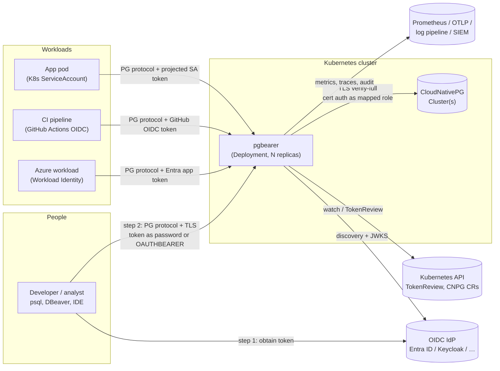
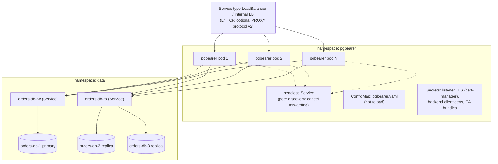
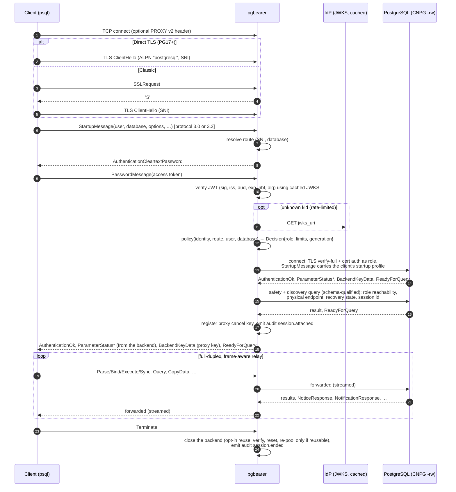
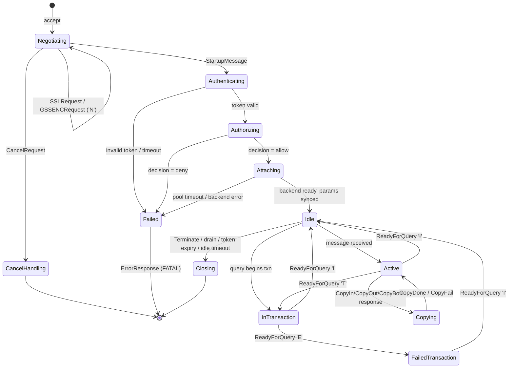

# pgbearer — Architecture

> Status: **design, partly implemented.** This document describes the target
> architecture. [PLAN.md](PLAN.md) describes the order in which it is built and
> the evidence gates each feature must pass. Decisions that are still open are
> marked **[open]**. Each one is settled through an ADR in `docs/adr/`.
>
> Revised on 12 October 2026 after the external design audit. The
> [audit response](docs/reviews/2026-10-09-audit-response.md) explains each
> change; references such as "F01" or "N3" point to it.

## Contents

1. [Purpose and scope](#1-purpose-and-scope)
2. [Lessons from gprxy](#2-lessons-from-gprxy)
3. [System context](#3-system-context)
4. [Deployment view (Kubernetes)](#4-deployment-view-kubernetes)
5. [Component view (Rust workspace)](#5-component-view-rust-workspace)
6. [Connection lifecycle](#6-connection-lifecycle)
7. [Wire protocol handling](#7-wire-protocol-handling)
8. [Client authentication (OIDC)](#8-client-authentication-oidc)
9. [Authorization and identity mapping](#9-authorization-and-identity-mapping)
10. [Backend connectivity and pooling](#10-backend-connectivity-and-pooling)
11. [Query cancellation across replicas](#11-query-cancellation-across-replicas)
12. [Session lifetime and token expiry](#12-session-lifetime-and-token-expiry)
13. [Configuration model](#13-configuration-model)
14. [CloudNativePG integration](#14-cloudnativepg-integration)
15. [Microsoft Entra ID integration](#15-microsoft-entra-id-integration)
16. [Observability and audit](#16-observability-and-audit)
17. [Security architecture](#17-security-architecture)
18. [Performance design](#18-performance-design)
19. [Failure modes](#19-failure-modes)
20. [Alternatives considered](#20-alternatives-considered)

---

## 1. Purpose and scope

**pgbearer** is a PostgreSQL wire-protocol proxy that runs in Kubernetes. It
authenticates clients with **OpenID Connect / OAuth 2.0 access tokens**,
authorizes them against a central policy, and connects them to PostgreSQL as a
**least-privilege database role**. It also pools backend connections and writes
an **audit trail tied to the real identity**.

People should not need database passwords. Workloads should use their platform
identity (Kubernetes ServiceAccount, Azure Workload Identity, GitHub Actions
OIDC). All access should be granted, reviewed and revoked in the identity
provider (IdP).

### Goals

| # | Goal |
|---|------|
| G1 | Work as a drop-in endpoint for the tested PostgreSQL clients (libpq/psql, pgjdbc, Npgsql, pgx, psycopg, asyncpg, node-postgres, tokio-postgres/sqlx), with documented exclusions. This includes the extended protocol, pipelining, COPY, LISTEN/NOTIFY, cancellation, and protocol 3.0 and 3.2. A client sees the same session defaults as with a direct connection. |
| G2 | Accept OIDC tokens from **several issuers** at once: Entra ID, Keycloak, Okta, Auth0, Dex, Google, Kubernetes ServiceAccounts and GitHub Actions. |
| G3 | Make the policy the only source of truth for *who* may connect to *which* cluster, database and role, with every decision explained in the audit log. |
| G4 | Hold **no shared superuser** and no long-lived human passwords. The backend login uses certificate authentication or per-role secrets. |
| G5 | Be **Kubernetes-native**: stateless, horizontally scalable, graceful drain, hot reload, first-class CloudNativePG support. |
| G6 | Be robust by construction: memory-safe Rust, bounded resources everywhere, fail closed, fuzzed protocol parser. |
| G7 | Add low overhead. The goal is under 100 µs p99 per round trip in session mode on the proxy's own path, to be confirmed by measurement (see §18). |
| G8 | Make every guarantee bounded and observable: revocation and expiry deadlines, per-replica limits, and an explicit "outcome unknown" when a request was in flight. |

### Non-goals (v1)

- Sharding, query rewriting or multi-backend fan-out (see PgDog/Citus).
- Acting as an identity provider or issuing tokens.
- Replacing PostgreSQL's own privilege system. pgbearer decides *which role* you
  get. PostgreSQL GRANTs and RLS decide *what that role may do*.
- GSSAPI/Kerberos for clients.

---

## 2. Lessons from gprxy

[gprxy](https://github.com/sathwick-p/gprxy) (Go, MPL-2.0) proves the concept:
SSO tokens sent as the PostgreSQL password and mapped to service accounts. A
review of its source at commit `02777248aead399f891b5a5dbd261fd25349b674` found
these structural problems, and they shape this design. pgbearer is an
independent implementation: no gprxy code or test fixtures are copied.

| # | gprxy behaviour | Consequence | pgbearer approach |
|---|---|---|---|
| L1 | The role-mapped service account is only used on a *temporary* authentication connection. Queries run on pooled connections that always log in with the global `GPRXY_USER`/`GPRXY_PASS`. | Role-based access control is not enforced on the data path. Every user gets the global service account's privileges. | The backend session logs in **as the role the policy chose** (§9). By default every client session gets its own backend session; opt-in reuse is keyed by role *and* startup profile (§10.3). |
| L2 | Each client login opens two backend connections (a temporary one for authentication, then a pooled one). | Double connection churn and latency, and the client sees ParameterStatus values from a different session. | One backend session per client session (session mode). Parameters are synthesized from the real backend (§7.4). |
| L3 | Lock-step relay: read one client message, forward it, then block until `ReadyForQuery`. | The extended protocol deadlocks (Parse/Bind/Execute/Sync are pipelined). COPY FROM STDIN, pipelining and async NOTIFY break. Only simple queries from psql work. | A full-duplex, frame-aware relay with a protocol state machine (§7.3). |
| L4 | The pool connection is held for the whole client session. `MaxConns=5` and `Acquire(context.Background())` has no timeout. | The 6th client hangs forever. It is not real pooling. | Bounded connection limits with acquire timeout, fair wait queues and SQLSTATE `53300` on exhaustion; transaction mode only as a gated, experimental feature (§10). |
| L5 | Startup parameters (`application_name`, `options`, `client_encoding`, …) are not applied to the pooled connection. | Encoding and search_path mismatches and silent behaviour differences. | The client's startup settings are forwarded in the backend StartupMessage, so they are true session defaults (§7.4, §10.4). |
| L6 | The backend's real PID and secret key are handed to clients. Cancel requests go to the hard-coded `DB_HOST:5432`, and the cancel registry is local to one process. | Cancellation fails behind a load balancer with more than one replica. Backend keys leak. | Proxy-generated cancel keys, peer forwarding between replicas, and protocol 3.2 long keys (§11). |
| L7 | The authentication connection to PostgreSQL is plain TCP. The pool relies on the driver default (`sslmode=prefer`, unverified). | Startup and SCRAM traffic is unencrypted inside the cluster. | `verify-full` TLS to backends by default, using the CNPG CA (§10.2). |
| L8 | Tokens are detected with an `eyJ` prefix check and silently fall back to password passthrough. Only RS256 is accepted, an `email` claim is required, and an unknown `kid` triggers a JWKS refetch with no rate limit. | Fails with Entra ID access tokens that lack `email`. The IdP can be used for amplification. Mistyped tokens are sent to PostgreSQL as passwords. | Explicit authentication methods per listener, configurable claims, an algorithm allow-list and a rate-limited JWKS cache (§8). |
| L9 | No token-expiry handling: a session lives forever after login. | Revocation in the IdP has no effect on open sessions. | A token-expiry policy with configurable grace and a maximum session lifetime (§12). |
| L10 | The cleartext password request is sent even when TLS is off. The CLI uses `InsecureSkipVerify`. | Tokens cross the network in clear text or to an unauthenticated server. | Token authentication **requires TLS**. The CLI verifies certificates (§17). |
| L11 | `wg.Add(1); go func(){ defer wg.Done(); go handle() }()` | Shutdown does not wait for connections. | Structured concurrency (`tokio` tasks plus a `TaskTracker`) and an explicit drain protocol (§4.3). |
| L12 | A failed `ROLLBACK`/`DISCARD ALL` still returns the connection to the pool. All SQL is logged at INFO. | Poisoned connections get reused. Secrets (for example `ALTER ROLE … PASSWORD`) end up in logs. | Connections that fail reset are discarded. Statement audit is opt-in and redacted (§16). |
| L13 | Configuration comes from environment variables, with `ROLE_MAPPING_X=user:password`. | Secrets sit in env vars and there is no hot reload. The setup is tied to Auth0. | A typed YAML configuration with schema, file-mounted secrets and hot reload (§13). |

---

## 3. System context



**Trust boundaries:** (a) client to pgbearer over the network, possibly from
outside the cluster; (b) pgbearer to the IdP over the internet; (c) pgbearer to
PostgreSQL inside the cluster; (d) pgbearer to the Kubernetes API.

---

## 4. Deployment view (Kubernetes)



### 4.1 Workload shape

- **Deployment** (stateless). There is no leader election. Every replica has
  its own pools.
- **Ports:** `5432` for PostgreSQL clients; `9090` for the admin HTTP server
  (`/livez`, `/readyz`, `/metrics`; read-only); `6543` for peer cancel
  forwarding (Phase 4), mTLS-authenticated and also restricted to pgbearer pods
  by NetworkPolicy.
- **Admin mutations** (reload, drain, purge) use a Unix socket inside the pod.
  Operators reach it with `kubectl exec … pgbearerctl admin …`, so Kubernetes
  RBAC on `pods/exec` is the authorization, and it works during an IdP outage.
  A bearer-token-protected TCP variant exists for non-Kubernetes use (F08).
- **PodDisruptionBudget** with `maxUnavailable: 1`, topology spread across
  zones, anti-affinity per node. Rollouts are paced with `minReadySeconds` ≥
  `drain.accept_grace + drain.hard_timeout`, so few pods drain at once (F09).
- **HorizontalPodAutoscaler** on CPU plus the custom metric
  `pgbearer_client_connections` (through KEDA or prometheus-adapter).
- **Security context:** non-root, read-only root filesystem, all
  capabilities dropped, `seccompProfile: RuntimeDefault`. The image is
  distroless or static.

### 4.2 Probes

| Probe | Semantics |
|---|---|
| `livez` | The runtime is responsive. The event-loop watchdog ticked within the last N seconds. |
| `readyz` | Listeners are bound, configuration is valid, and JWKS is loaded for every *required* issuer. Readiness is **not** gated on backend reachability. During a database outage, clients should get a proper PostgreSQL error (`08006`), not a refused TCP connection. |
| `startupProbe` | The same as `readyz`, with a longer budget for the first JWKS fetch. |

### 4.3 Graceful drain

Triggered by SIGTERM or the admin API:

1. `readyz` returns 503 immediately, and the endpoint is removed from the
   Service.
2. The proxy keeps accepting connections for `drain.accept_grace` (default
   5 s) to cover endpoint-propagation delay, then closes its listeners.
3. Idle pooled backend connections are closed at once, and no new backend
   connection is opened after `accept_grace`. A draining pod only ever holds
   fewer backend connections.
4. Sessions may finish for up to `drain.session_timeout`. Each session then
   receives `FATAL 57P01 admin_shutdown` at its next **safe point** (§6.1:
   nothing in flight, status `I`).
5. At `drain.hard_timeout` the remaining sessions are force-closed: a backend
   CancelRequest first, a bounded wait, then the sockets are closed. A client
   with a request in flight gets `08007` (outcome unknown), never `57P01`,
   because its statement may have committed (§19).
6. Cancel forwarding for the pod's sessions keeps working until the last
   session ends (Phase 4: the peer port stays open, and peer discovery
   includes not-ready pods).
7. `terminationGracePeriodSeconds` must be greater than
   `accept_grace + hard_timeout + 5s`. The Helm chart computes it.

### 4.4 Exposure options

| Option | When to use it |
|---|---|
| ClusterIP only | In-cluster workloads. |
| Internal LoadBalancer (Azure/AWS/GCP internal LB) | Developers on VPN or ExpressRoute or private network. **Recommended** for human access. |
| Public LoadBalancer + IP allow-list | Only if required. Tokens are still mandatory and TLS is enforced. |
| Gateway API `TLSRoute` (passthrough) | Only with **direct TLS** clients (PostgreSQL 17+ `sslnegotiation=direct`). The ALPN `postgresql` and SNI are then visible to the gateway. |
| Gateway API `TCPRoute` | Any client. The gateway does L4 forwarding only. |

**Multi-tenant routing by SNI:** libpq has sent SNI since PostgreSQL 14
(`sslsni=1`), both after `SSLRequest` and with direct TLS. One pgbearer
deployment can front many CNPG clusters, for example
`orders.db.example.com` and `billing.db.example.com`, behind one load balancer,
using a wildcard certificate.

---

## 5. Component view (Rust workspace)

```text
pgbearer/
├── crates/
│   ├── pgbearer-core/       # Shared types: Identity, SessionId, ClientError, SQLSTATEs
│   ├── pgbearer-wire/       # PG protocol codec: framing, message views, startup/SSL/GSS/cancel,
│   │                        # protocol 3.0/3.2 negotiation. No I/O policy. Fuzzed.
│   ├── pgbearer-tls/        # rustls server/client configs, SNI/ALPN, cert hot-reload
│   ├── pgbearer-auth/       # OIDC discovery, JWKS cache, JWT validation, claim mapping,
│   │                        # SASL OAUTHBEARER (server), TokenReview, backend auth (SCRAM/cert)
│   ├── pgbearer-policy/     # Identity model, policy rules → Decision
│   ├── pgbearer-pool/       # Endpoints, discovery (static/DNS/CNPG), pools, health, limits
│   ├── pgbearer-session/    # Client session state machine, startup profile, relay state,
│   │                        # cancel registry & peer forwarding, (later) txn pooling
│   ├── pgbearer-audit/      # Audit event model + sinks
│   ├── pgbearer-telemetry/  # tracing, metrics registry, OTLP
│   ├── pgbearer-config/     # Typed config, JSON schema, validation, hot reload (arc-swap)
│   ├── pgbearer/            # bin: the proxy server (wiring, admin HTTP via axum,
│   │                        # feature "kubernetes": CNPG watch)
│   └── pgbearerctl/         # bin: CLI — login (PKCE/device), token, connect, doctor
├── deploy/helm/pgbearer/    # Helm chart
├── deploy/examples/         # CNPG + Entra ID, CNPG + Keycloak, kind dev setup
├── docs/adr/                # Architecture Decision Records
├── fuzz/                    # cargo-fuzz targets (wire codec, SASL, JWT parsing)
└── tests/                   # integration + e2e harness (testcontainers, kind)
```

Dependency direction: `core ← wire ← auth/session ← pool ← pgbearer`. `policy`
depends only on the identity types in `core`. Kubernetes-specific code lives in
the binary behind the `kubernetes` feature, so the proxy also runs outside
Kubernetes. A separate `pgbearer-k8s` crate is created only once that boundary
has proven itself (F20).

### 5.1 Key crates (initial choices, confirmed in ADRs)

| Concern | Choice | Rationale |
|---|---|---|
| Async runtime | `tokio` (multi-thread) | Ecosystem standard. `TaskTracker` and `CancellationToken` give structured shutdown. |
| Buffers | `bytes`, `tokio-util::codec` | Zero-copy framing. |
| TLS | `rustls` + `tokio-rustls`, `aws-lc-rs` provider | Memory-safe, ALPN/SNI support, FIPS-capable provider. |
| JWT/JWKS | `jsonwebtoken` behind an internal `TokenVerifier` trait | Mature; RS/PS/ES/EdDSA support. The trait allows swapping it. |
| HTTP client (JWKS, discovery) | `reqwest` (rustls, no native-tls) | Timeouts, proxy support, connection reuse. |
| Admin HTTP | `axum` | Small, tower middleware. |
| Config | `serde` + a maintained YAML implementation **[open]**, `schemars` for JSON Schema | `serde_yaml` is unmaintained. Evaluate `serde-saphyr` and `serde_norway`. |
| Hot reload | `arc-swap` | Lock-free reads of the current configuration snapshot. |
| Metrics | `prometheus-client` (OpenMetrics) | Official, typed, no global registry. |
| Tracing and logs | `tracing`, `tracing-subscriber` (JSON), `opentelemetry-otlp` | Structured logs and distributed traces. |
| Kubernetes | `kube` + `k8s-openapi` | Watchers and CRDs in Rust. |
| Secrets in memory | `secrecy`, `zeroize` | Tokens and keys never `Debug`-print and are wiped on drop. |
| SQL inspection (optional) | `pg_query` (libpg_query) behind feature `sql-inspect` | Exact PostgreSQL grammar for audit fingerprinting and statement policy. A C dependency, hence opt-in. |
| CLI | `clap`, `keyring`, `oauth2` | Token cache in the OS keychain. |

**Own wire codec instead of `pgwire`:** `pgwire` is designed to *implement* a
PostgreSQL-compatible server and decodes messages fully. A proxy needs
header-only framing with streaming of large bodies and minimal copying, in
both directions, and it needs the frontend side as well. Ideas and test
vectors come from `postgres-protocol`, PgDog and pgcat. This is ADR-002.

---

## 6. Connection lifecycle



### 6.1 Session state machine



The diagram is a simplification. A `ReadyForQuery 'I'` does **not** by itself
mean the session is idle: with pipelining, later Queries, an open extended
batch (Parse/Bind/Execute without Sync) or a partly forwarded frame can still
be in flight. Every decision that needs "idle" uses the predicates of the
relay state in §7.3:

* **safe point** (`idle_safe_point`): idle timeout, drain, token expiry and
  revocation act here first;
* **reusable**: the only state in which a backend may be re-pooled (opt-in
  reuse) or detached (experimental transaction mode).

In **session mode** (the default) the backend stays attached until `Closing`,
and by default it is closed rather than re-pooled. In the experimental
**transaction mode**, the backend is detached only when it is reusable with
status `I` (§10.5).

---

## 7. Wire protocol handling

### 7.1 Framing

- Startup-phase packets have no type byte (`int32 len | int32 code | …`). The
  proxy recognises `StartupMessage` (196608 = 3.0, 196610 = 3.2),
  `SSLRequest` (80877103), `GSSENCRequest` (80877104, always answered `'N'`) and
  `CancelRequest` (80877102). A TLS record (`0x16`) is recognised as the first
  byte of **direct TLS**.
- Regular messages are `u8 type | int32 len | body`. The codec parses **only
  the 5-byte header** on the fast path. Bodies are streamed: a 500 MB
  `DataRow` or `CopyData` is never buffered whole.
- Hard limits before authentication: startup packet ≤ 10 000 bytes (the same as
  PostgreSQL's `MAX_STARTUP_PACKET_LENGTH`, and also the cap for the forwarded
  backend StartupMessage), password/SASL message ≤ 16 KiB (configurable; Entra
  tokens with many groups can be large), and an authentication timeout of
  10 s. After authentication, messages are bounded by PostgreSQL's own limits
  and streamed.
- Read buffers start small and grow only while reads keep filling them; they
  shrink back when a connection is idle, so idle connections cost little
  memory (F19).
- Cancellation safety: a body read or copy that is cancelled part-way poisons
  the reader. The stream is then unframed and the connection is closed, never
  retried (N9).

### 7.2 Protocol versions

- Supports **3.0** and **3.2** (PostgreSQL 18). With 3.2 the cancel secret is
  variable length (4–256 bytes), and the proxy issues 32-byte secrets.
- An unknown minor version (3.3 and later) or `_pq_.*` options are answered
  with `NegotiateProtocolVersion`, listing the highest supported minor version
  and the unrecognised options, as the protocol specifies.
- The backend protocol version is negotiated independently of the client's.
  Message formats that differ (BackendKeyData, CancelRequest) are translated at
  the proxy.

### 7.3 Relay

The relay is **full-duplex**: two pumps (client → backend and backend →
client) run concurrently, so a slow reader in one direction never blocks the
other. Control events (drain, idle timeout, token expiry, revocation, cancel)
arrive on a channel. They set a flag that the pumps act on **at frame
boundaries**. Only a hard deadline drops the pumps, and then a client socket
whose backend → client direction is mid-frame is closed without writing, so
a proxy-generated error is never interleaved into a half-sent `DataRow`.

The pumps update a `RelayState` **only after a whole frame has been
forwarded** (F12, ADR-017):

| Tracked | Updated by | Why |
|---|---|---|
| `expected_rfq` | +1 per forwarded `Query`, `Sync`, `FunctionCall`; −1 per backend `ReadyForQuery` | Responses still owed by the backend. A `Z` with nothing expected is a protocol violation. |
| `ext_open` | Set by `Parse`/`Bind`/`Describe`/`Execute`/`Close`/`Flush`; cleared by `Sync` | An extended batch without Sync is an *implicit transaction*: a later Sync (from anyone) commits it. |
| `mixed` | A `Query` or `FunctionCall` while `ext_open` | The backend may discard it after an error, so counting is uncertain. |
| COPY state | Backend `CopyInResponse`/`CopyOutResponse` until `CopyDone`/`CopyFail`/backend `CopyDone`; `CopyBothResponse` is unsafe | Never interrupt or detach mid-COPY. A Sync pipelined before an extended COPY starts may be ignored, which makes the count uncertain. |
| Partial frames | Header forwarded, body not finished (each direction) | The stream is unframed until the body completes. |
| Writer flushed / client bytes buffered | Writers and readers | Nothing may be pending in pgbearer itself. |
| `tx_status` | Last `ReadyForQuery` | `I`/`T`/`E`. |
| Fatal, protocol error, uncertain, cancel forwarded this lease | Errors, tracker violations, the cancel registry | Make the connection non-reusable. |
| `ParameterStatus` | Backend | Keep the client-visible parameter set accurate. |
| `Terminate` (client) | Client | Intercepted; the session closes the backend itself. |

Predicates:

* **quiescent** = `expected_rfq == 0`, no `ext_open`, no COPY, no partial
  frame, writers flushed, `tx_status == I`, and none of the fatal, protocol
  error, mixed or uncertain flags.
* **idle_safe_point** = quiescent, with no client bytes buffered.
* **reusable** = quiescent, no cancel forwarded during the lease, backend
  reader at a frame boundary.

Over-counting is allowed (a connection is then merely not reused);
under-counting must be impossible, which property tests over random message
interleavings check. The session hands the pool a `ReleaseVerdict` (reusable,
or the reason it is not); the pool re-checks it.

Asynchronous backend messages (`NoticeResponse`, `NotificationResponse`,
`ParameterStatus`) are forwarded whenever they arrive, also while idle in
session mode. Replication connections (`replication=true|database`) are
rejected; `replication=false/off/0/no` is treated as absent.

### 7.4 Startup profile and parameter synthesis

Settings a client sends in its StartupMessage (directly, or as `-c` entries in
`options`) are **session defaults** in PostgreSQL: they set the value that
`RESET`, `RESET ALL` and `DISCARD ALL` return to. A later `SET` or
`set_config()` cannot reproduce that, because it runs at a lower source
priority and never changes the reset value. `SET` with a quoted literal also
breaks list settings: `search_path = 'a, b'` becomes one schema named
`"a, b"` (F01, N1).

pgbearer therefore **forwards the client's settings in the backend
StartupMessage** (ADR-016). The `StartupProfile` is built as follows:

1. `options` is split exactly as PostgreSQL's `pg_split_opts` does
   (whitespace separation, backslash escapes). Only `-c name=value`,
   `-cname=value` and `--name=value` are accepted. Any other switch (`-P`,
   `-W`, `-d`, `-e`, `-f`, `-S`, …) is rejected with `0A000`.
2. Names are lower-cased and, for `options`-derived names, `-` becomes `_`.
   PostgreSQL's precedence applies (options first, then direct keys, last
   wins). Duplicate `user`, `database` or `options` keys are rejected with
   `08P01`.
3. A hard deny-list is rejected with `42501`: `role`,
   `session_authorization`, `pgbearer.*`, `replication` (other than false),
   the connect-time-only settings `post_auth_delay`, `ignore_system_indexes`,
   `local_preload_libraries`, `session_preload_libraries`,
   `jit_debugging_support`, `jit_profiling_support`, plus `log_connections`
   and `log_disconnections`. An optional allow-list mode is available.
4. Everything else is forwarded as individual keys; the backend validates it
   exactly as for a direct connection. A user-settable setting sent at
   startup is no more powerful than the same `SET` after login, and
   superuser-only settings fail for the mapped role. Errors the client caused
   (`22023`, `42704`, `42501`, `3D000`) are passed through with their
   SQLSTATE and never count as backend failures.
5. The profile is an ordered canonical list of at most 64 entries. It is
   hashable, so it can be part of a reuse key (§10.3). The whole backend
   StartupMessage, including identity propagation keys (§9.3), must fit in
   10 000 bytes, or the client gets a clear error.

`application_name` and `client_encoding` are the client's own values; they
are not replaced. Raw `options` and `_pq_.*` keys are never forwarded.

The client must also see the **real** `server_version`, `server_encoding`,
`integer_datetimes` and so on. The proxy relays the attached backend's own
`ParameterStatus` messages, which now reflect the client's settings as well.

Because client settings such as `search_path` and `statement_timeout` now
apply to pgbearer's internal queries too, every internal statement is fully
schema-qualified (`pg_catalog.` functions and catalogs,
`OPERATOR(pg_catalog.=)`), uses the extended protocol with parameters, and
treats a failure caused by client settings as a client error (N11).

---

## 8. Client authentication (OIDC)

### 8.1 Client-facing methods

| Method | Client support | Notes |
|---|---|---|
| **Token as password** (`AuthenticationCleartextPassword`) | Clients that send a password on request. Clients configured to require channel binding or SCRAM only (`channel_binding=require`, `require_auth=scram-sha-256`) will not send it, even over TLS. | **Requires TLS**: the listener refuses cleartext auth on a non-TLS connection unless `insecure_allow_plaintext_auth` is set. The same UX as Azure Database for PostgreSQL with Entra ID. Clients should use `sslmode=verify-full`. |
| **SASL `OAUTHBEARER`** (RFC 7628) | libpq/psql ≥ 18 built with OAuth support (`oauth_issuer`, `oauth_client_id`); built-in Device Authorization flow (RFC 8628), not on Windows. | No helper tool needed: psql runs the device flow itself. The proxy answers the discovery exchange with the issuer's `/.well-known/openid-configuration` URL and the required scope, from the provider configured for the listener (never from the client). The discovery connection opens no backend connection, and no backend is held while a person completes the device flow. Preview until gate G4. |
| mTLS client certificate **[later]** | All clients. | For workloads with SPIFFE/cert-manager identities. |

**Selecting the method.** libpq picks `OAUTHBEARER` whenever the server offers
it, and clients without OAuth support fail. So the method cannot be negotiated
in-band. It is chosen **per listener or route**, for example a dedicated port
or an SNI hostname like `oauth.orders.db.example.com`. The default is token as
password.

### 8.2 Validation pipeline

```text
raw token ─► size check ─► JWT? ──no──► introspection (RFC 7662) [later] / reject
                              │yes
                              ▼
             header: alg ∈ allow-list (RS256, PS256, ES256, EdDSA; never none/HS*), kid present
                              ▼
             issuer selection: unverified `iss` → configured IdP (exact match, no prefix tricks)
                              ▼
             JWKS lookup (cache) → signature verify
                              ▼
             claims: iss == configured; aud ∈ audiences; exp required; nbf/iat with leeway
                     (default 60 s); exp − iat ≤ max_token_lifetime;
                     optional: typ == "at+jwt" (RFC 9068 IdPs; Entra uses "JWT"),
                     azp/appid allow-list, tid allow-list
                              ▼
             token profile: exactly one of the provider's profiles must match
                     (Entra: delegated = scp with a required scope, no idtyp=app;
                      application = idtyp=app, no scp, non-empty roles);
                     no `nonce` (ID tokens); ambiguous or no match → reject
                              ▼
             Identity { issuer, subject, username, tenant, groups, roles, scopes, client_id,
                        kind: Human|Workload|Unknown, expires_at, token_id, key_id }
```

- **The issuer is selected from configuration, never discovered from the
  token.** An unknown `iss` is rejected before any network call.
- Validation errors produce a generic client message (`28P01`, "token
  validation failed"). The precise reason goes only to the audit log and
  metrics.
- `kind` is attested by a token profile, never guessed. A generic OIDC token
  without a declared profile has kind `Unknown`, which a deny rule on `kind`
  treats as a possible match (§9.1).
- A stolen bearer token can be replayed to pgbearer until it expires.
  `max_token_lifetime` (default 24 h; 1 h for GitHub Actions) bounds that
  window even when the IdP issues long-lived tokens. Proof-of-possession
  tokens are a Phase 7 item.

### 8.3 JWKS cache

- Per-issuer discovery (`/.well-known/openid-configuration`) and JWKS fetch at
  startup. Readiness waits for required issuers.
- Background refresh at `max(Cache-Control max-age, min_refresh)`, capped at
  `max_age` (default 1 h).
- **Unknown `kid`:** a single-flight refresh with a minimum interval (default
  30 s) per issuer, so an attacker cannot turn pgbearer into a JWKS-fetch
  amplifier.
- A successful refresh **replaces** the key set atomically, so keys removed by
  the IdP stop working at the next refresh.
- **Stale-while-error:** if refresh fails, keep the last good key set for up to
  `max_stale` (default 24 h), raise an alert metric, and never drop to an empty
  set. This is an availability trade-off, not a security property.
- **Emergency key purge:** `revoked_key_ids` per provider rejects tokens signed
  with those keys at once, whatever the cache holds. Sessions authenticated with
  a purged key are revoked (§12), using the `key_id` kept on each identity.
- Keys are accepted when `use` is absent or `sig`, and `alg`, if present, must
  match the header.
- HTTP: https only, TLS 1.2+, response bodies ≤ 1 MiB, ≤ 64 keys, timeouts,
  and redirects only to the same origin. The discovery document's `issuer`
  must equal the configured issuer exactly.

### 8.4 Issuer types

| Type | Validation | Typical subject |
|---|---|---|
| `oidc` (generic) | Discovery + JWKS | `sub`, or a configured claim. |
| `entra` | `oidc` plus Entra defaults: subject `oid`, `tid` allow-list, v2 issuer format, token profiles `delegated` (`scp`) and `application` (`idtyp=app`, `roles`), groups-overage detection. The API audience must differ from any public client ID. | `oid` (immutable object ID); the identity key is (issuer, `tid`, `oid`). UPN and email are display data only. |
| `kubernetes` | JWKS from the cluster issuer (offline: cannot see a deleted ServiceAccount or pod before the token expires), **or** the `TokenReview` API (Phase 4; authoritative at review time, cached for at most `min(exp, 60 s)`, fails closed). A dedicated audience is required: the API server's own audience is rejected, because automounted tokens with that audience can live about a year. | `system:serviceaccount:<ns>:<name>`; grants can pin the account UID (`/kubernetes.io/serviceaccount/uid`) so a recreated account does not inherit access. |
| `github-actions` | `oidc` preset for `https://token.actions.githubusercontent.com`; tenant = `repository_owner_id` (immutable). Grants should also require `repository_id`, `environment`, `ref` and `job_workflow_ref`/`workflow_ref`, and exclude `pull_request` events (F16). | `repo:<org>/<repo>:environment:<env>` |

### 8.5 Groups and roles

- Prefer **app roles** (`roles` claim) over groups for authorization. They are
  scoped to the application, have no overage problem, and work for both users
  and service principals.
- **Groups overage (Entra ID):** with more than 200 groups, a JWT carries no
  `groups` claim, only `_claim_names`/`_claim_sources` (or `hasgroups`).
  pgbearer detects this and treats the group data as **unknown**: a grant
  that needs it does not match, and a deny rule that depends on it **fires**
  (§9.1), with a clear audit reason. An optional resolver can query Microsoft
  Graph `transitiveMemberOf` with pgbearer's own workload identity and a cache
  (PLAN Phase 7). The recommended fix is to emit only "groups assigned to the
  application".

---

## 9. Authorization and identity mapping

### 9.1 Policy model

A policy is a list of **grants**. Each grant has a `when` (a predicate over
the identity and the connection) and a `grant` (what may be accessed). The
rules are:

- **Default deny.** No matching grant means the connection is refused
  (`28000`).
- **Explicit `deny` rules win** over grants. Examples: block a tenant, block
  a compromised subject or token. `deny[].terminate: immediate` also ends
  matching active sessions at once (§12).
- **Three-valued conditions.** Each condition evaluates to *true*, *false* or
  *unknown*. Unknown arises when the data needed is missing: groups overage, a
  provider that does not emit groups, an absent claim, or kind `Unknown`. A
  grant matches only when every condition is *true*. A deny rule fires when
  its conditions are *true or unknown*, unless it sets `on_unknown: ignore`.
  Unknown data can therefore never grant access or bypass a deny (F04, F05).
- **Issuer-scoped.** Every grant names its issuer (subjects and role names
  are only unique per issuer). Deny rules may omit it, which only widens them.
- **Candidates are filtered per request.** Only grants whose backend and
  database match the routed request are considered, and the role must come
  from one of them. Entitlements of unrelated grants never combine.
- **Order-independent merging** when several grants match: every per-identity
  limit is enforced; the session lifetime is the minimum; the expiry action
  is the strictest; conflicting default roles are a deny ("name a role as
  user"); conflicting pool modes resolve to session mode and are audited.
  Per-grant overrides may only tighten the global settings.
- The **requested startup `user`** selects a role among the entitlements:
  - `user` equal to an entitled `pg_role` → that role.
  - `user` equal to the identity's username (for example the UPN) or `*` → the
    grant's `default_pg_role`.
  - Anything else → deny. (`user_semantics: role | identity | auto`, default
    `auto`.)
- Each decision records the matched grant names, and they are written to the
  audit event.

```yaml
policies:
  - name: orders-analysts
    when:
      issuer: entra
      roles_any: ["Orders.Analyst"]        # Entra app role
    grant:
      backend: orders
      databases: ["orders"]
      pg_roles: ["orders_readonly"]
      default_pg_role: orders_readonly
      max_sessions_per_identity_per_replica: 5

  - name: orders-api
    when:
      issuer: k8s
      subject: "system:serviceaccount:orders:orders-api"
    grant:
      backend: orders
      databases: ["orders"]
      pg_roles: ["orders_app"]

  - name: orders-migrations
    when:
      issuer: github
      subject: "repo:acme/orders:environment:production"
      claims:
        - { name: repository_id, equals: "123456789" }
        - { name: ref, equals: "refs/heads/main" }
        - { name: job_workflow_ref, equals: "acme/orders/.github/workflows/migrate.yml@refs/heads/main" }
    grant:
      backend: orders
      databases: ["orders"]
      pg_roles: ["orders_owner"]
      acknowledged_role_risks: [database_owner]
      session_max_lifetime: 30m

deny:
  - name: no-guests
    when:
      issuer: entra
      claims:
        - { name: acct, equals: 1 }    # Entra guest accounts (optional claim "acct")
    # The provider lists "acct" in required_claims, so it is never unknown.
    # Without that, the deny would also fire for tokens that lack the claim.
```

Claim names are looked up literally first, then as a dotted path, and a name
starting with `/` is an RFC 6901 JSON Pointer
(`/kubernetes.io/serviceaccount/uid`). Paths are validated when the
configuration is loaded.

The rule language is deliberately small and declarative in v1. Expression
support (CEL) and external engines (OPA/Cedar) are post-1.0 options (PLAN
Phase 7) behind the same `PolicyEngine` trait. Time-window rules are not
supported: they would require scheduled re-evaluation of active sessions.

### 9.2 Backend identity strategies

pgbearer must log in to PostgreSQL **as the chosen role**, so that PostgreSQL's
privilege system, RLS, `current_user` and pgaudit all see the effective role.
There are three ways to authenticate that login:

| Strategy | How | Pros | Cons |
|---|---|---|---|
| **A. Certificate + `pg_ident` (recommended)** | pgbearer holds **one** client certificate (CN=`pgbearer`) from the cluster's client CA. In `pg_ident.conf`, `pgbearer pgbearer +pgbearer_login` lets that certificate log in as any **member of `pgbearer_login`** (`+role` syntax, PostgreSQL 16+). | No passwords anywhere. One secret to rotate (automatic with CNPG or cert-manager). The set of reachable roles is controlled *in the database* through `GRANT pgbearer_login TO …`. | Needs PostgreSQL 16+. The certificate must be available in the pgbearer namespace. Identities that share a mapped role can see and signal each other's sessions through SQL (N28). |
| **B. Per-role client certificates** | A CNPG 1.30+ `DatabaseRole` with `clientCertificate: {}` issues a Secret named after the `DatabaseRole` *resource* (`<resource-name>-client-cert`), and pgbearer mounts one per role. | Native CNPG with automatic renewal. No `pg_ident` map needed. | One secret per role. |
| **C. Per-role passwords** | SCRAM-SHA-256 with passwords from Secrets (CNPG `passwordSecret`). | Works with any PostgreSQL (including managed services outside Kubernetes). | Passwords to rotate. The proxy holds many credentials. |

**Why not one "authenticator" login plus `SET ROLE`** (the PostgREST pattern)?
A client can run `RESET ROLE` or `SET ROLE other` (or the
`set_config('role', …)` equivalent) and move to any role the authenticator is
a member of. That is privilege escalation unless every statement is parsed and
filtered, and parsing PL/pgSQL, `DO` blocks and functions is not something
security should depend on. With strategy A, a `SET ROLE` can only reach roles
the *mapped* role itself is a member of, which is ordinary PostgreSQL
semantics under the DBA's control.

**Role design guidance** (shipped as docs and examples):

```sql
CREATE ROLE pgbearer_login NOLOGIN;      -- gate for strategy A: no privileges, owns nothing, member of nothing
CREATE ROLE orders_readonly LOGIN;
GRANT pgbearer_login TO orders_readonly WITH INHERIT FALSE, SET FALSE;  -- PG16+: membership only
GRANT USAGE ON SCHEMA orders TO orders_readonly;
GRANT SELECT ON ALL TABLES IN SCHEMA orders TO orders_readonly;
ALTER DEFAULT PRIVILEGES FOR ROLE orders_owner IN SCHEMA orders GRANT SELECT ON TABLES TO orders_readonly;
-- Avoid pg_read_all_data and other predefined roles for ordinary grants: they reach every
-- database the role can connect to. Never grant pg_signal_backend to mapped roles.
```

`+pgbearer_login` in `pg_ident` matches members regardless of their
`INHERIT`/`SET` options, so `WITH INHERIT FALSE, SET FALSE` keeps the gate role
from leaking anything granted to it. (CNPG `inRoles` cannot set these options;
keep the gate role empty in that case.)

**Role reachability check (ADR-015).** A role's own attributes say little:
membership can allow `SET ROLE` into a superuser group, inherited
memberships carry privileges, and ADMIN OPTION lets a role grant itself
another role. On every new backend connection pgbearer runs one
schema-qualified recursive query over `pg_auth_members` that follows SET,
INHERIT and ADMIN edges (PostgreSQL 16+ semantics) and classifies every
reachable role:

| Risk class | Meaning | Default |
|---|---|---|
| `superuser`, `createrole`, `replication`, `bypassrls` | Role attributes anywhere in the reachable set | **Refused** unless acknowledged |
| `server_files` | `pg_read_server_files`, `pg_write_server_files`, `pg_execute_server_program` | **Refused** unless acknowledged |
| `admin_option` | ADMIN OPTION on any reachable role (self-grant) | **Refused** unless acknowledged |
| `predefined_admin` | `pg_signal_backend`, `pg_write_all_data`, `pg_create_subscription`, `pg_use_reserved_connections`, `pg_maintain`, `pg_checkpoint`, `pg_signal_autovacuum_worker` | **Refused** unless acknowledged |
| `database_owner`, `createdb`, `read_all` | Owns a database; CREATEDB; `pg_read_all_data`/`pg_read_all_stats`/`pg_monitor`… | Allowed, warned and audited |

A grant acknowledges risks explicitly with
`acknowledged_role_risks: [...]` (the old `allow_privileged_role: true`
means "all" and is deprecated). Grants for the same backend and role must
acknowledge the same set; validation rejects a mismatch. The risk set is
stored on the connection, compared with the request on **every** acquire
(so a connection opened for a break-glass grant can never serve an ordinary
one), and re-checked when it is older than `role_check_ttl` (60 s).
PostgreSQL sends no notification of role changes, so a TTL is the bound;
grants made during a live session take effect at once, which is why this is
defence in depth and not a guarantee.

`pgbearerctl doctor` runs the same walk for every member of the gate role,
lists ADMIN holders, checks that the gate role is empty, and **reports**
`SECURITY DEFINER` functions owned by privileged roles that the mapped roles
can execute. Report only: no query can prove a function safe.

### 9.3 Identity propagation (audit, not authorization)

pgbearer sends `pgbearer.sub`, `pgbearer.username` and `pgbearer.session_id`
as keys in the backend StartupMessage, so they are session defaults and
survive the client's `RESET ALL` and `DISCARD ALL` (§7.4). With opt-in reuse,
per-lease values are set with a parameterised
`SELECT pg_catalog.set_config($1, $2, false)` after the reset. Values are
never interpolated into SQL, and values containing NUL are rejected. pgbearer
can also append the identity to `application_name` (opt-in, because some
apps read it). These values make PostgreSQL logs and `pg_stat_activity`
correlatable with pgbearer's audit log, which also records the backend PID,
the database session id (`%c`) and the connection's local address (§16.3).

> ⚠️ A client can overwrite these GUCs within its own session. They are
> **audit hints, not a security boundary**. Do not base RLS policies on them.
> When per-person RLS is needed, use **personal roles** (PLAN Phase 7: JIT
> provisioning of one PostgreSQL role per identity), so that `current_user`
> itself is the identity.

---

## 10. Backend connectivity and pooling

### 10.1 Backends and discovery

| Kind | Resolution |
|---|---|
| `static` | `host:port` list. DNS is re-resolved on connect (TTL-respecting). |
| `cnpg` | `Cluster` name + namespace + service (`rw`/`ro`/`r`) → `<cluster>-<svc>.<ns>.svc:5432`. The `Cluster` CR is also **watched** for `status.currentPrimary`, `targetPrimary` and phase (§10.6). |

### 10.2 TLS to the backend

The default is `verify-full`. For CNPG the CA comes from the `<cluster>-ca`
Secret (`ca.crt`), and the server name is the Service DNS name, which CNPG
puts in the server certificate. SCRAM channel binding
(`SCRAM-SHA-256-PLUS`, `tls-server-end-point`) is used when strategy C is
used over TLS.

### 10.3 Pools

- **Reuse is off by default** (`pool.reuse: none`). Every client session
  gets a fresh backend connection that is closed at the end. The pool then
  acts as a connection limiter with fair queuing. This removes the cancel and
  reset races from the pilot (F01, F02).
- **Opt-in reuse** (`pool.reuse: same_identity | same_role`, Phase 3a):
  - **Key:** `(generation, backend, database, pg_role, startup profile[,
    identity])`. A different startup profile never shares a connection.
  - **Release:** only with a `reusable` verdict (§7.3). Then `DISCARD ALL`
    (the only reset; not configurable) whose reply must be exactly
    `CommandComplete('DISCARD ALL')` and `ReadyForQuery('I')`. Anything else,
    a FATAL, or a cancel forwarded during the lease discards the connection.
  - **Acquire:** buffered or immediately readable input on an idle connection
    is drained first: `ParameterStatus` is recorded, `NoticeResponse`
    dropped, and `NotificationResponse`, `ErrorResponse` or EOF discard it.
    The role-risk check (§9.2) applies on every acquire.
  - **Not reset by `DISCARD ALL`:** extension and library state (dblink
    connections, PL/Python `GD`/`SD`, PL/Perl `%_SHARED`), `setseed()` state,
    the backend PID and start time. Use `same_identity` where this matters.
- **Generations:** every pooled connection carries the generation of the
  configuration and credentials it was opened under. `retire(selector, mode)`
  closes idle connections at once and drains or terminates active ones by a
  deadline; acquire never returns, and release never re-pools, a retired
  generation (F07).
- **Limits** (all **per replica**): `pool.max_connections` per pool,
  `max_backend_connections` per backend (all pools to one cluster),
  `max_sessions_per_identity_per_replica` per grant, `max_client_connections`,
  and `max_pools` per backend. Pool entries are created only after a
  successful connect, so client-chosen database names cannot fill the
  registry.
- **Acquire:** a FIFO wait queue with `acquire_timeout` (default 5 s). On
  timeout the client gets `53300 too_many_connections` with a hint. A backend
  `53300` ("too many clients") is passed through as `53300` with its own
  metric reason.
- **Health:** test-on-borrow only when the connection has been idle longer
  than `health_check_idle`. `max_lifetime` has ±10 % jitter, plus
  `idle_timeout`. Connect failures back off exponentially with jitter per
  backend (100 ms – 5 s); client-caused startup errors never count.
- **Sockets:** `SO_KEEPALIVE` and `TCP_USER_TIMEOUT` on client and backend
  sockets; backend startup parameters `tcp_keepalives_idle=30`,
  `tcp_keepalives_interval=10`, `tcp_keepalives_count=3` and
  `client_connection_check_interval=10s` (configurable), so orphaned backends
  end when pgbearer or a node disappears (F14).

**Connection budget.** pgbearer never enforces a fleet-wide budget; each
replica enforces its own limits. For every PostgreSQL instance *i*:

```text
usable_i = max_connections − superuser_reserved_connections − reserved_connections
           − cnpg_internal − other consumers (poolers, direct apps, jobs, admin) − margin
demand_i = Σ over pgbearer deployments d and their backends b that can reach i:
             B(d,b) × (R_d + S_d + T_d)  +  O_i
require    demand_i ≤ usable_i   for every instance (size all instances alike:
           any replica can be promoted)
```

* **B** = effective per-pod cap = min(`max_backend_connections`, Σ pool
  limits).
* **R** = HPA `maxReplicas` (or `replicas`).
* **S** = absolute `maxSurge`.
* **T** = pods terminating while still holding backend connections. Up to R
  with fast rollouts or a `minAvailable` PDB; about S + 1 with
  `minReadySeconds ≥ accept_grace + hard_timeout` and PDB
  `maxUnavailable: 1`. Kubernetes does not count terminating pods against
  `maxSurge`.
* **O** = orphaned backends from pods lost without a FIN, bounded in time by
  the server-side keepalive settings above.
* For `-ro`/`-r` backends, assume the whole budget can land on one instance.

Single deployment, single cluster: `B ≤ floor((usable − O) / (R + S + T))`.
The chart's optional `connectionBudget` check validates operator-supplied
numbers at render time; `pgbearer_backend_instance_slots` and an alert show
what actually happens at runtime.

### 10.4 Session parameters

Client settings are forwarded in the backend StartupMessage (§7.4), never
replayed with `SET`. With opt-in reuse the startup profile is part of the
pool key, so a reused connection always starts from exactly the defaults the
client asked for. pgbearer does not compare or patch parameters on checkout.
`ParameterStatus` replies keep the client-visible record accurate, and a
reported value that differs from the profile at a reusable point makes the
connection non-reusable.

### 10.5 Pooling modes

| Mode | Semantics | Default for |
|---|---|---|
| `session` | One backend connection is bound for the client's lifetime. Fully compatible: LISTEN/NOTIFY, session GUCs, temporary tables, advisory locks, SQL `PREPARE`, `WITH HOLD` cursors. By default the connection is closed afterwards (`pool.reuse: none`). | Everyone. **Global default.** |
| `transaction` | **Experimental** (Phase 3b, gate G4). Requires `experimental.transaction_pooling: true`; validation rejects it otherwise, and it is never silently replaced by session mode. | High-concurrency workloads that accept the documented limits. |

The first version of transaction mode (ADR-010 is written before any code):

- **Identity-scoped pools** by default (the key includes issuer and subject).
  Hidden leftover session state then stays within one principal. Sharing
  across identities of the same role is an explicit opt-in.
- **Detach** only when the relay state is `reusable` with status `I` (§7.3).
  A cancel forwarded during the lease, a FATAL or a protocol error discards
  the connection.
- **Pin** the backend to the client for the rest of its session when pgbearer
  observes a named prepared statement or portal, a reported GUC that differs
  from the profile, a `NotificationResponse` (LISTEN), an extended-protocol
  COPY, or any uncertainty. With `on_named_statement: error` the client gets
  `0A000` with driver hints (`prepareThreshold=0`, `statement_cache_size=0`,
  `QueryExecModeExec`) instead.
- **No reset between transactions.** Leftover state (temporary tables, SQL
  `PREPARE`, advisory locks, `WITH HOLD` cursors, `set_config` inside
  functions) is documented, not detected. SQL inspection is a diagnostic
  aid, never the security boundary: a function can change settings or take
  locks invisibly.

**Prepared-statement virtualisation** comes later, behind its own evidence:
an ordered per-client queue of expected backend responses (to place
synthesised `ParseComplete`/`CloseComplete` and drop the replies to injected
`Parse`); a statement key of query text plus parameter types within a
profile-keyed pool; reference counts so statements used by pipelined
`Bind`/`Describe` are never evicted; per-client, per-backend and global byte
budgets; `Describe` always answered by the backend. Settings frozen at parse
time (`DateStyle`, `TimeZone`, `standard_conforming_strings`) are why the
pool must be profile-keyed. This is the approach of PgBouncer 1.21+ and
PgDog, which serve as comparisons, not as a specification.

### 10.6 CloudNativePG failover and switchover

The `Cluster` CR watch is an **accelerator**, not the source of truth: the
`-rw` Service can lag the CR, and pgbearer can run without API access.

1. **After every connect**, the safety query checks target suitability:
   `-rw` requires `pg_is_in_recovery() = false`, `-ro` requires `true`. On a
   mismatch the connection is discarded and the connect is retried with
   bounded, jittered backoff.
2. **When `currentPrimary` changes**, the read-write generation of that
   cluster is bumped. Idle connections of the old generation close at once,
   and **active read-write sessions on the old primary are closed
   immediately** (configurable to `at_idle`). An isolated old primary
   performs a *smart* shutdown, during which sessions that are already open
   can keep committing for up to `smartShutdownTimeout` (180 s by default),
   while a replica may already have been promoted. `pg_is_in_recovery()`
   cannot detect this, because the old primary is not in recovery; only the
   CR (or the pod IP) can.
3. Connection errors invalidate by **endpoint** (`invalidate_endpoint(addr)`),
   so losing one `-ro` instance affects only connections pinned to it.
4. Clients whose request was in flight get `08007` (outcome unknown); clients
   that were idle get `08006`, with "transaction was not committed" when a
   transaction was open (§19). pgbearer never replays SQL.

---

## 11. Query cancellation across replicas

PostgreSQL sends a `CancelRequest` on a **new** TCP connection, which the load
balancer may route to a **different** pgbearer replica. The design is ADR-005
(the audit's appendix C, amended).

- pgbearer **never exposes backend keys**. Each client session gets a
  proxy-generated key: `pid` (32 bit) = `replica_tag (11 bit) | session_seq
  (20 bit)` with the top bit clear, so the pid is always positive, and
  `secret` = CSPRNG bytes (4 bytes with protocol 3.0, 32 bytes with 3.2). The
  pid a driver reports therefore differs from `pg_backend_pid()`; correlate
  through the audit log or `pgbearer.session_id` instead. Sequence numbers
  are checked against live entries before reuse.
- **Ownership, not timing.** The cancel registry maps a key to the lease that
  is *currently* attached. A valid cancel, in one per-session critical
  section, checks that a lease is attached and marks it **poisoned** before
  anything is sent. A poisoned lease is discarded at release, never re-pooled.
  A cancel for a session with no attached lease is dropped. There is no
  timer: socket writes and delays cannot prove that PostgreSQL has handled a
  cancel.
- **Physical endpoint.** The safety query records `inet_server_addr()`,
  `inet_server_port()` and `pg_backend_pid()`. When the pid matches
  `BackendKeyData`, the backend cancel goes to that address; otherwise (for
  example behind PgBouncer) to the connected address, as libpq does
  (`backend.cancel_endpoint: discovered | connected`). A cancel sent through
  a `-ro` Service would otherwise reach the right replica only by chance. The
  TLS verify name stays the Service name, and the cancel connection uses the
  session's TLS mode; the secret is sent only after verification.
- **Coalescing and limits.** At most one backend cancel is in flight per
  lease; further ones are coalesced. Cancels are rate-limited per source IP
  and per session. Outcomes are counted as `dispatched`, `coalesced`,
  `no_backend` and `failed`, never "succeeded".
- **Internal statements.** A cancel that lands during pgbearer's own
  statements (safety query, reset, per-lease `set_config`) discards the
  connection; the client sees no error from it.
- **Across replicas (Phase 4).** If the key is not local and the
  `replica_tag` belongs to a peer, the receiving replica forwards the packet
  to that peer's **peer port** (`6543`) over **mTLS** with a
  deployment-scoped CA. If the tag is unknown or ambiguous it is sent to all
  peers, with bounded fan-out and concurrency; peer-received cancels are
  never forwarded again. Peers are discovered through a headless Service with
  `publishNotReadyAddresses: true`, so draining pods stay reachable, and a
  draining pod keeps its peer port open until its last session ends.
  **Until Phase 4 ships, cancels that reach a replica that does not own the
  session are dropped**; with two replicas that is about half of them.

Unknown keys are dropped silently, as PostgreSQL does. Shared mapped roles are
a separate path: PostgreSQL lets members of a role cancel or terminate each
other's backends through SQL (`pg_cancel_backend`), which the proxy cannot
prevent.

---

## 12. Session lifetime and token expiry

Access tokens typically live 60–90 minutes, while PostgreSQL sessions can last
much longer. Every deadline below is **hard**: continuous activity cannot
extend it (ADR-014, the audit's appendix D, amended).

| Setting | Default | Behaviour |
|---|---|---|
| `on_token_expiry` | `terminate_when_idle` | After `exp + token_expiry_grace` the session is closed at its next safe point with `FATAL 28000` ("credentials expired; reconnect with a fresh token"). `terminate` closes it at `exp + grace` regardless. |
| `token_expiry_grace` | `60s` | Operational slack for running work (separate from the validation leeway). |
| `token_expiry_hard_timeout` | `120s` | At `exp + grace + hard_timeout` the session is force-closed in every mode. A grant may extend it to at most 1 h for batch work. |
| `revocation.hard_timeout` | `60s` | When a reload revokes a session (grant removed, deny added, role or route changed), it closes at its next safe point, and at the latest after this deadline. |
| `deny[].terminate` | `at_safe_point` | `immediate` ends matching sessions at once, for emergencies. |
| `max_lifetime` | `12h` | Hard cap regardless of token. Per-grant values may only be shorter. |
| `idle_timeout` | `1h` | Client idle (no transaction open). |
| `idle_in_transaction_timeout` | `10m` | Protects backends from forgotten open transactions. |

`on_token_expiry: ignore` no longer exists.

**Re-evaluation.** Policy, routes and session settings are published as a
snapshot with a generation (§13). Each session keeps its validated identity
facts (never the raw token), its request, its decision and the generation it
was decided under. When a new generation arrives it re-evaluates itself: a
stricter result tightens its timers, a deny or a changed role or route
revokes it. The generation is re-checked after the session registers, which
closes the race with a concurrent reload. Tokens validated with a key listed
in `revoked_key_ids` are revoked the same way.

**Forced close.** If a request is in flight, pgbearer first sends the backend
a CancelRequest and waits up to about 2 s for the error and
`ReadyForQuery`. Only then does it send the client a FATAL and close both
sockets. Without this, PostgreSQL would notice the closed socket only at its
next socket I/O (or after `client_connection_check_interval`), and a revoked
statement could still commit. A client whose request was in flight at a hard
deadline gets `08007` (outcome unknown), because a COMMIT may have completed.

**Published bounds.**

- *Local policy change:* ConfigMap propagation (kubelet sync, typically up to
  about a minute) + `revocation.hard_timeout`.
- *IdP change that pgbearer cannot see* (role removed, user disabled):
  token lifetime (≤ `max_token_lifetime`) + grace + hard timeout. There is no
  instant offboarding and no Entra Continuous Access Evaluation.
- *Database effect:* bounded by the cancel above; a statement that ignores the
  cancel ends at the server's next socket check.

PostgreSQL has no in-band re-authentication, so a client cannot refresh the
token on an open session. Application pools must fetch a fresh token for
**every new physical connection** (Npgsql password provider, pgx
`BeforeConnect`, asyncpg callable password, a JDBC `DataSource` wrapper) and
keep their `maxLifetime` shorter than the token lifetime. `pgbearerctl`
refreshes tokens before connecting.

---

## 13. Configuration model

- A **single YAML file** (`pgbearer.yaml`), versioned (`apiVersion:
  pgbearer/v1alpha1`), with a published **JSON Schema** for editor
  validation. Unknown fields are an error.
- **Secrets are referenced as files** (`*_file`), mounted from Kubernetes
  Secrets **as directories** (never `subPath`, which never updates).
  Environment variables are only for overrides (`PGBEARER_LOG`, …).
- **Hot reload:** a file watcher on the mounted directory, plus SIGHUP, plus
  `pgbearerctl admin reload` over the admin socket. The new configuration is
  fully parsed and validated before it is applied. An invalid configuration
  is rejected, the old one stays active, and
  `pgbearer_config_reload_errors_total` is incremented.
  - **Applied live** (a new generation): policies, deny rules, routes and
    session settings. Active sessions are **re-evaluated** (§12).
  - **Restart required:** listeners, identity providers and backends. These
    changes are reported in the reload outcome, in
    `pgbearer_config_pending_restart{section}` and in `/readyz` detail, and are
    never applied silently. A reload that would *remove* backend trust (a CA,
    the TLS mode, the host) is refused unless explicitly allowed; for a
    credential compromise use `pgbearerctl admin purge <backend>`, which
    retires the backend's generation and ends its sessions by a deadline.
  - `pgbearer_config_info{generation, sha256}` shows which configuration
    every replica runs, so fleet convergence is observable.
  - An optional, separately mounted **denylist** file is polled every few
    seconds for emergency denies; it survives restarts and needs no rollout.
- TLS certificates (listener and backend client certificates) are reloaded on
  file change, which handles cert-manager and CNPG rotation without a restart.
  A certificate and key that do not match are rejected and the last good pair
  stays in use. Rotation affects only new handshakes: it is **not**
  revocation (§14.2).
- The Helm chart rolls pods only when restart-required sections change.

```yaml
apiVersion: pgbearer/v1alpha1
kind: ProxyConfig

listeners:
  - name: postgres
    address: "0.0.0.0:5432"
    tls:
      cert_file: /etc/pgbearer/tls/tls.crt
      key_file: /etc/pgbearer/tls/tls.key
      min_version: "1.2"
      direct_tls: true                 # PG17+ sslnegotiation=direct (ALPN "postgresql")
    proxy_protocol: "off"              # off | optional | required (the latter two need trusted_proxies)
    client_auth: token_password        # token_password | oauthbearer

identity_providers:
  - name: entra
    type: entra
    issuer: "https://login.microsoftonline.com/<tenant-id>/v2.0"
    audiences: ["<pgbearer-api-client-id>"]     # Entra v2 tokens: aud = API client ID
    tenants: ["<tenant-id>"]
    token_profiles: [delegated, application]
    required_scopes: ["Database.Connect"]       # delegated (user) tokens
    max_token_lifetime: 24h
    oauthbearer:                                # used only by oauthbearer listeners
      scope: "api://pgbearer/Database.Connect"
  - name: k8s
    type: kubernetes
    audiences: ["pgbearer"]                     # dedicated audience, never the API server's
  - name: github
    type: github-actions
    audiences: ["pgbearer"]

backends:
  - name: orders
    cnpg: { cluster: orders-db, namespace: data, service: rw }
    tls:
      mode: verify-full
      ca_file: /etc/pgbearer/backends/orders/ca.crt
    login:
      method: cert                              # cert | password
      cert_file: /etc/pgbearer/backends/orders/client/tls.crt
      key_file: /etc/pgbearer/backends/orders/client/tls.key
    pool:
      reuse: none                               # none | same_identity | same_role
      max_backend_connections: 20               # per replica; see the budget in §10.3
      acquire_timeout: 5s

routes:
  - match: { sni: "orders.db.example.com" }
    backend: orders
  - match: { databases: ["orders"] }            # fallback when no SNI
    backend: orders

policies: [...]                                  # see §9.1

session:
  on_token_expiry: terminate_when_idle
  token_expiry_grace: 60s
  token_expiry_hard_timeout: 120s
  max_lifetime: 12h

revocation:
  hard_timeout: 60s

audit:
  stdout: true
  delivery: best_effort                          # best_effort | required
```

Settings shown here that the current configuration crate does not have yet
(`token_profiles`, `max_token_lifetime`, `pool.reuse`, `revocation`,
`audit.delivery`, `token_expiry_hard_timeout`) are added in Phase 2.

---

## 14. CloudNativePG integration

### 14.1 What pgbearer needs from a CNPG cluster

```yaml
apiVersion: postgresql.cnpg.io/v1
kind: Cluster
metadata:
  name: orders-db
  namespace: data
spec:
  instances: 3
  imageName: ghcr.io/cloudnative-pg/postgresql:18
  # CNPG 1.29+: pin certificate logins to pgbearer pods (same namespace only).
  podSelectorRefs:
    - name: pgbearer
      selector: { matchLabels: { app.kubernetes.io/name: pgbearer } }
  postgresql:
    parameters:
      max_connections: "200"                     # size with the budget in §10.3
      client_connection_check_interval: "10s"   # end orphaned work promptly
    pg_ident:
      - "pgbearer pgbearer +pgbearer_login"
    pg_hba:
      # Must come before any broader rule for these users (first match wins).
      - "hostssl orders +pgbearer_login ${podselector:pgbearer} cert map=pgbearer"
      # Fail closed: if the selector matches nothing the rule above is omitted,
      # and this guard stops a later, broader rule from matching.
      - "hostssl all +pgbearer_login all reject"
---
apiVersion: postgresql.cnpg.io/v1
kind: DatabaseRole                      # CNPG 1.30+
metadata:
  name: orders-readonly
  namespace: data
spec:
  cluster: { name: orders-db }
  name: orders_readonly
  login: true
  inRoles: [pgbearer_login]   # table privileges come from the schema owner's migrations (§9.2)
```

Notes:

- `${podselector:NAME}` works only for pods in the Cluster's own namespace.
  When pgbearer runs elsewhere, use NetworkPolicy plus an explicit CIDR rule
  and do not claim selector pinning. Verify the rendered rules
  (`pg_hba_file_rules`, `pg_ident_file_mappings`) after every change.
- Whoever can write the `Cluster` or `DatabaseRole` objects, or label pods in
  the namespace, is part of the trusted administration boundary.

### 14.2 Getting the pgbearer client certificate

| Option | Description |
|---|---|
| **cert-manager** (recommended) | CNPG in "user-provided client CA" mode with a cert-manager `Issuer` backed by that CA. A namespaced `Issuer` can only use a CA Secret in its own namespace, so the `Certificate` with `commonName: pgbearer` is issued in the cluster's namespace (run pgbearer there, as the example does), or through a `ClusterIssuer` whose CA Secret lives in cert-manager's namespace. Never copy the CA private key into the pgbearer namespace. Rotation is handled by cert-manager, and pgbearer hot-reloads. |
| CNPG `DatabaseRole` with `clientCertificate` (1.30+) | Create a `DatabaseRole` for a `pgbearer` login (no privileges) with `clientCertificate: {}`. The Secret is named after the `DatabaseRole` *resource* (`<resource-name>-client-cert`) and created in the *cluster's* namespace. Either run pgbearer in that namespace, or replicate the Secret (External Secrets, Reflector) into the pgbearer namespace. |
| `kubectl cnpg certificate` | Manual or one-off. Not recommended for production rotation. |

**Rotation is not revocation.** Reissuing or deleting a client Secret only
affects future handshakes; a stolen certificate signed by the same CA stays
valid until it expires. To revoke: remove the reachable roles or the HBA
line, rotate CA trust (or use CRLs where operated), then purge active
sessions (`pgbearerctl admin purge`, §13). Anyone who can read the client CA's
private key can mint certificates for `streaming_replica` or for the gateway,
which makes them superuser-equivalent.

Reading the `<cluster>-ca` and client certificate Secrets through the API
(RBAC-scoped) instead of volume mounts is evaluated in Phase 4 **[open]**.

### 14.3 Relationship to the CNPG `Pooler` (PgBouncer)

pgbearer connects **directly to `<cluster>-rw` / `-ro`** and does its own pooling.
Placing it in front of a CNPG `Pooler` is possible but not recommended:
PgBouncer would need to authenticate as every mapped role, which defeats
strategy A. Applications with static credentials can keep using the CNPG
Pooler alongside pgbearer.

### 14.4 PostgreSQL 18 native OAuth

PostgreSQL 18 can validate OAuth tokens itself through a server-side
**validator module** (`oauth_validator_libraries`, `pg_hba` method `oauth`).
pgbearer complements that rather than competing with it:

- pgbearer works with **PostgreSQL 16+** backends and with drivers that send
  a password. Native OAuth requires libpq 18 clients, and today most non-libpq
  drivers do not support it.
- pgbearer centralises policy, audit and pooling across **many clusters** and
  needs no validator module in the database image.
- pgbearer **speaks OAUTHBEARER to clients** (§8.1). A PostgreSQL 18 user gets
  the native psql device-flow UX either way.

---

## 15. Microsoft Entra ID integration

### 15.1 App registrations

1. **`pgbearer` (resource API):**
   - *Expose an API*: App ID URI `api://pgbearer`, delegated scope
     `Database.Connect`.
   - *App roles* (for example `Orders.Reader`, `Orders.Owner`) with *allowed
     member types: Users/Groups + Applications*. Use them in policies
     (`roles_any`).
   - Manifest: **`api.requestedAccessTokenVersion: 2`**
     (`accessTokenAcceptedVersion` in the legacy manifest). Otherwise the
     tokens are v1 (`iss = https://sts.windows.net/<tid>/`), which does not
     match the v2 discovery document.
   - If your tenant's app management policy requires it, use
     `api://<client-id>` instead of `api://pgbearer` throughout.
   - Enterprise application: *Assignment required = Yes*, so only assigned
     users and groups can obtain tokens at all.
   - Optional groups claim: "Groups assigned to the application" (avoids
     overage).
   - Optional claims on the access token: **`idtyp`** (required for the
     `application` token profile, so app-only tokens are recognised) and
     `acct` if deny rules use it (then list it in `required_claims`).
2. **`pgbearer-cli` (public client):** a **separate** registration from the
   API, so its ID tokens can never carry the API's audience. "Allow public
   client flows" (device code), redirect URI `http://localhost` (PKCE
   loopback), and API permission `api://pgbearer/Database.Connect` with admin
   consent.
3. **Azure CLI convenience:** pre-authorize the Azure CLI client application
   on the `pgbearer` API. Users can then get a token without any pgbearer tooling:

   ```bash
   export PGPASSWORD=$(az account get-access-token \
       --scope api://pgbearer/Database.Connect --query accessToken -o tsv)
   psql "host=orders.db.example.com dbname=orders user=orders_readonly sslmode=verify-full"
   ```

   `PGPASSWORD` is visible to the user's other processes (for example through
   `/proc/<pid>/environ`) for the life of the shell. `pgbearerctl psql` avoids
   this with a short-lived `0600` passfile.

4. **psql 18 native (OAUTHBEARER listener):**

   ```bash
   psql "host=oauth.orders.db.example.com dbname=orders user=orders_readonly \
         sslmode=verify-full sslrootcert=system \
         oauth_issuer=https://login.microsoftonline.com/<tenant-id>/v2.0 \
         oauth_client_id=<pgbearer-cli-client-id>"
   # → "Visit https://microsoft.com/devicelogin and enter the code: XXXX-XXXX"
   ```

### 15.2 Claims used

| Claim | Use |
|---|---|
| `iss`, `aud`, `exp`, `nbf`, `iat` | Standard validation. With v2 tokens, `aud` is the **API's client ID** (GUID). |
| `tid` | Tenant allow-list (mandatory for `type: entra`). |
| `oid` | **Subject**: immutable object ID, used for audit and per-identity limits. The identity key is (issuer, `tid`, `oid`). |
| `preferred_username` / `upn` | Display and audit only. **Never** for authorization (mutable). |
| `scp` | Delegated scopes (user tokens), for example `Database.Connect`. Required by the `delegated` token profile. |
| `roles` | App roles (users and applications), the preferred authorization input. Must be non-empty for the `application` token profile. Their presence alone never decides human versus workload. |
| `groups`, `_claim_names`, `hasgroups` | Group IDs and overage detection (§8.5). |
| `azp` / `appid`, `idtyp` | Client allow-list. `idtyp=app` identifies application tokens and is required by the `application` profile. |
| `acct` (optional claim, must be enabled) | `1` = guest account, which can be used in deny rules. |

### 15.3 Workloads on AKS

Pods with **Azure Workload Identity** use the client-credentials flow for
`api://pgbearer/.default`. The token carries app `roles` assigned to the managed
identity or service principal, has `idtyp=app` (with the optional claim
enabled) and no `scp`, so it matches the `application` profile only. App-role
assignments removed after issuance stay in the token until it expires (§12). For workloads inside the same Kubernetes cluster,
the **`kubernetes` issuer type is simpler**: a projected ServiceAccount token
with `audience: pgbearer` needs no Entra configuration.

---

## 16. Observability and audit

### 16.1 Metrics (Prometheus / OpenMetrics, `:9090/metrics`)

No per-user labels, to keep cardinality bounded. Per-identity data belongs in
the audit log.

| Metric | Labels |
|---|---|
| `pgbearer_client_connections` (gauge) | `listener`, `state` |
| `pgbearer_auth_attempts_total` | `issuer`, `result`, `reason` |
| `pgbearer_auth_duration_seconds` (histogram) | `issuer` |
| `pgbearer_policy_decisions_total` | `result`, `grant` |
| `pgbearer_pool_connections` (gauge) | `backend`, `database` (`*` for wildcard grants), `role`, `state` |
| `pgbearer_pool_acquire_duration_seconds` (histogram) | `backend` |
| `pgbearer_pool_acquire_timeouts_total` | `backend` |
| `pgbearer_backend_connect_errors_total` | `backend`, `reason` |
| `pgbearer_transactions_total`, `pgbearer_transaction_duration_seconds` | `backend`, `mode` |
| `pgbearer_bytes_total` | `direction` |
| `pgbearer_cancel_requests_total` | `result` (`dispatched`, `coalesced`, `forwarded`, `no_backend`, `unknown_key`, `failed`) |
| `pgbearer_cancel_endpoint_fallback_total` | `backend`, `reason` |
| `pgbearer_jwks_refresh_total`, `pgbearer_jwks_age_seconds` | `issuer`, `result` |
| `pgbearer_tls_cert_expiry_timestamp_seconds` | `cert` |
| `pgbearer_config_reload_total`, `pgbearer_config_reload_errors_total` | — |
| `pgbearer_config_info` (info), `pgbearer_config_generation` | `generation`, `sha256` |
| `pgbearer_config_pending_restart` (gauge) | `section` |
| `pgbearer_sessions_terminated_total` | `reason` (`token_expired`, `token_expired_hard`, `policy_revoked`, `emergency_deny`, `key_purged`, `drain`, `idle`, `lifetime`, `backend_lost`) |
| `pgbearer_sessions_pending_revocation` (gauge), `pgbearer_revocation_seconds` (histogram) | — |
| `pgbearer_limit_per_replica` (gauge) | `limit`, `backend` |
| `pgbearer_admission_rejections_total` | `reason` |
| `pgbearer_backend_instance_slots` (gauge) | `backend`, `instance`, `kind` (`max`, `reserved`, `used`) |
| `pgbearer_audit_events_dropped_total`, `pgbearer_audit_queue_depth`, `pgbearer_audit_write_errors_total` | — |

The Helm chart ships a `ServiceMonitor`, a `PrometheusRule` (alerts: JWKS stale,
certificate expiring, pool saturation, authentication-failure spike, backend
slots above 85 %, configuration not converged, audit events dropped), and a
Grafana dashboard.

### 16.2 Logs and traces

- Structured JSON logs (`tracing`) to stdout. Tokens, passwords and keys are
  wrapped in `Secret<T>` and cannot be logged by construction.
- OTLP traces cover the startup (auth → policy → acquire) and, if enabled,
  sampled transactions. W3C trace context can be passed in through
  `application_name` or a startup option **[open]**.

### 16.3 Audit events

A separate stream (`log.type = "audit"`) with a stable schema
(`pgbearer.audit/v1`, extended additively). Every event carries an envelope
with `seq` (per process, so gaps are visible), `instance_id` (random per
process start) and `replica` (pod name).

| Event | Key fields |
|---|---|
| `connection.authenticated` | `session_id`, `issuer`, `subject`, `username`, `tenant`, `client_id`, `key_id`, `client_addr` and `client_addr_source` (`tcp` or `proxy`), `tls` (version, SNI), `listener`, `auth_method` |
| `connection.denied` | Same fields plus `stage` (`token`/`policy`/`limit`), `reason` (precise, internal) |
| `backend.connected` | `physical_connection_id`, `backend`, `peer_addr` (actually connected), `local_addr`, `tls_server_name`, login role, `backend_pid`, `backend_session_id` (PostgreSQL `%c`), server version, role risks |
| `backend.closed` | `physical_connection_id`, `reason`, `lease_count` |
| `session.attached` | `session_id`, `lease_id`, `physical_connection_id`, `fresh`, `backend`, `database`, `pg_role`, `matched_grants`, `config_generation` |
| `session.detached` | `lease_id`, `reusable`, `reason` |
| `session.revoked` | `session_id`, `generation`, `rule`, `soft`/`hard` |
| `session.ended` | `session_id`, `duration`, `bytes_in/out`, `end_reason` |
| `config.applied` | `generation`, `sha256`, `applied`, `restart_required` |
| `cancel` | `session_id`, `result` |

**Guarantees.** Attach events are enqueued *before* `ReadyForQuery` is sent
and before any client byte reaches the backend. Emitting never blocks the
relay: events go to a bounded queue drained by a dedicated thread. With
`audit.delivery: best_effort` (default) an overflowing queue drops events,
counts them and leaves a gap in `seq`. With `required`, which needs an
acknowledging sink (not stdout), new attaches for affected grants are refused
while the sink is unhealthy. After a SIGKILL no `session.ended` is written;
orphans show up as attached events without an end for a dead `instance_id`.

**Correlation.** `instance_id` + `physical_connection_id` + `backend_session_id`
+ the connection's local address join the audit trail to PostgreSQL logs
(`%c`, `%r`) and `pg_stat_activity`. `application_name` and the
`pgbearer.*` GUCs are client-writable and recorded as untrusted hints. The
gateway attributes *connections*; exact *statement* attribution to a person
needs personal roles plus pgaudit (Phase 7). Usernames (UPN) are personal
data: they are included by default and can be omitted. Statement auditing is
not part of pgbearer; use pgaudit.

---

## 17. Security architecture

### 17.1 Threats and mitigations (summary; full STRIDE model in `docs/threat-model.md`)

| Threat | Mitigation |
|---|---|
| Token theft in transit | TLS mandatory for token authentication; TLS 1.2+ (1.3 preferred); HSTS-like refusal of cleartext. |
| Token replay against another service | Strict `aud`; a `typ=at+jwt` check where the IdP issues RFC 9068 tokens; `azp`/`appid` allow-list; token profiles; `max_token_lifetime`. A stolen token can still be replayed to pgbearer itself until it expires. |
| Forged tokens or algorithm confusion | Algorithm allow-list, no `none`/HS*, the configured issuer decides the JWKS (never the `jku`/`x5u` headers). |
| Escalation through `SET ROLE` or role membership | Log in as the mapped role (§9.2); role reachability check with acknowledged risks; identity settings blocked in the startup profile (§7.4). |
| Lateral movement via the backend credential | Strategy A is limited to `pgbearer_login` members, and superusers are excluded. pg_hba restricts the certificate login to proxy pod IPs (CNPG `podSelectorRefs` with a reject guard) and to entitled databases, plus NetworkPolicy. |
| Forged client address (PROXY header) | PROXY accepted only from `trusted_proxies`; the audit records the address source. |
| Hijack of internal queries via client settings | Every internal statement is schema-qualified and parameterised (§7.4). |
| Unknown claims bypassing deny rules | Three-valued policy evaluation; deny on unknown (§9.1). |
| Pre-authentication DoS (slowloris, huge packets) | Pre-auth size and time limits, `max_pending_auth` connections, per-IP connection and authentication-failure rate limits. |
| IdP amplification via random `kid` | Single-flight, rate-limited JWKS refresh (§8.3). |
| Cancel abuse or cross-borrower cancel | Proxy-issued keys with 32-byte secrets on 3.2; poison-and-discard ownership; coalescing and rate limits; mTLS between peers; never a backend key. |
| Secrets in logs or memory dumps | `secrecy`/`zeroize`; statement audit opt-in with redaction; core dumps disabled in the image. |
| Supply chain | `cargo-deny` (licences, advisories, sources), `cargo-audit`, pinned toolchain, reproducible builds, SBOM (CycloneDX), cosign keyless signatures, SLSA provenance. |
| Memory-safety bugs | `#![forbid(unsafe_code)]` in the project's own crates; fuzzing of codec, SASL and JWT parsing (cargo-fuzz in CI, OSS-Fuzz later). |

### 17.2 Hardening defaults

- `client_auth: token_password` refuses non-TLS connections.
- Default deny in policy. An empty policy means no access.
- Probes and metrics on a separate, read-only port that the default Service
  does not expose. Admin mutations only through a local Unix socket
  (`pods/exec` RBAC), or a bearer-token-protected TCP listener outside
  Kubernetes.
- PROXY protocol off; replication connections rejected.
- FIPS build option: the `aws-lc-rs` FIPS provider, behind a feature flag.

---

## 18. Performance design

- **Fast path:** in session mode without statement audit, only 5-byte headers
  are parsed. Bodies move between `BytesMut` buffers with vectored writes. Large
  messages are streamed with a known remaining length.
- **Backpressure:** bounded per-connection buffers that start small, grow
  only while reads fill them (cap 64 KiB by default, configurable) and shrink
  when idle. If the client reads slowly, pgbearer stops reading from the
  backend. pgbearer never accumulates result sets in memory.
- **Memory budget:** reported separately as incremental heap per idle client
  connection (goal ≤ 32 KiB), incremental memory per attached session
  (including the backend leg and both TLS states), fixed process RSS, kernel
  socket memory (charged to the pod under cgroup v2) and PostgreSQL backend
  memory. Defaults are kept consistent with the chart's memory limit, and
  pgbearer warns at startup when `max_client_connections` cannot fit in the
  cgroup's `memory.max`.
- **Authentication cost:** JWT verification with a cached JWKS is about
  50–200 µs (RSA-2048 verify). The main latency is the backend connect (TCP,
  TLS and certificate authentication). With the default of no reuse every new
  session pays it; opt-in reuse (§10.3) avoids it.
- **Goals**, not results until measured:
  - Session-mode added latency: p50 < 30 µs, p99 < 100 µs per round trip at
    moderate load.
  - Throughput: ≥ 90 % of direct `pgbench -S` TPS at 64 clients.
  - Connection storm: 1 000 new authenticated connections per second per vCPU.
    This depends on the listener key type (ECDSA P-256 signs far faster than
    RSA-2048) and TLS session resumption, and with no reuse it also depends on
    the backend connect.
- **Method:** every published number records hardware and CPU pinning, both
  TLS legs and their versions, key types, resumption, warm or cold JWKS and
  pool, result sizes, sample count, p50/p99/p99.9 and error rate, paired with
  direct PostgreSQL and PgBouncer. Hosted CI gates on deterministic
  instruction counts; wall-clock latency, throughput and soak run on a
  dedicated runner.
- **io_uring** (`tokio-uring`/`monoio`) is deliberately deferred (ADR) until
  benchmarks show the epoll path is the bottleneck.

---

## 19. Failure modes

| Failure | Behaviour |
|---|---|
| IdP unreachable | Existing JWKS is used (stale-while-error up to `max_stale`). New `kid` values fail. Alert. Emergency denies and admin operations still work (denylist file, admin socket). |
| JWKS empty or invalid at startup | Not ready. The pod receives no traffic. |
| Backend down before attach | Clients get `08006` / `57P03` / `53300` with a clear message; safe to retry. Connects back off with jitter. Readiness is unaffected. |
| Backend lost, no request in flight | `08006`; with a transaction open, the detail says it was not committed. |
| Backend lost with a request in flight | `08007` ("the outcome of the in-flight request is unknown"). A COMMIT, an autocommit statement or a `CALL` may have completed. pgbearer never replays SQL; applications use idempotency keys or reconciliation (runbook). |
| CNPG switchover or failover | The read-write generation is bumped; old-primary sessions are closed (§10.6). New connections are checked for target suitability. Backend errors and notices (for example the synchronous-replication "committed locally" warning) are forwarded before closing. |
| Pool exhausted | `53300` after `acquire_timeout`. Metric and alert. A backend "too many clients" is also passed through as `53300`. |
| Config reload invalid | Rejected. The old configuration stays active. Metric and log. |
| Config change needs a restart | Reported (`pgbearer_config_pending_restart`, `/readyz` detail); never applied silently. |
| Certificate rotated | Hot reloaded. Existing TLS sessions are unaffected. Rotation is not revocation (§14.2). |
| Drain hard timeout, token expiry hard deadline, revocation | Backend cancel first, bounded wait, then close. `08007` if a request was in flight, otherwise `57P01` (drain) or `28000` (expiry, revocation). |
| pgbearer pod killed (SIGKILL, OOM) or node lost | Clients see a connection reset (or, without a FIN, a hang bounded by TCP keepalive) and reconnect elsewhere. A request in flight has an unknown outcome: an autocommit statement already running completes and commits, and a COMMIT may or may not have completed. Backends that were idle in a transaction roll back when PostgreSQL notices the lost connection, bounded by the server-side keepalive and `client_connection_check_interval` settings pgbearer sends (§10.3). No `session.ended` audit event is written. |
| Kubernetes API unreachable | CNPG watch is degraded and falls back to error-driven invalidation and target-suitability checks. TokenReview issuers fail closed. JWKS-based issuers are unaffected. |

---

## 20. Alternatives considered

| Alternative | Why not (as the primary design) |
|---|---|
| **Extend gprxy (Go)** | The core relay (L3) and backend identity (L1) need a redesign anyway. Rust gives memory safety without GC pauses, a strong type system for protocol state, and the same ecosystem as PgDog and pgcat. |
| **PgBouncer + `auth_query`** | No OIDC. Its plugin model is not suited to token validation and policy. |
| **PgDog / pgcat** | Strong poolers (Rust). PgDog is AGPL-3.0, and neither centres on OIDC identity and policy. They are reference material for ideas; no code or fixtures are copied. |
| **PostgreSQL 18 native OAuth only** | Requires libpq 18 clients and a validator module per cluster. No pooling, and no cross-cluster policy or audit (§14.4). Complementary. |
| **Teleport Database Access** | A mature access plane with SSO, RBAC, access requests and database audit. It is a larger platform with its own agents and client tooling (`tsh`); pgbearer aims to be a small, Kubernetes-native gateway that ordinary drivers reach with a token as password. A pilot should compare the two on deployment effort and client compatibility. |
| **Identity gateway in front of PgBouncer** | Possible for transaction pooling, but PgBouncer would have to log in as every mapped role, which defeats strategy A (§14.3). |
| **`pgwire` crate** | Built for implementing servers, with full decode. Not optimal for a streaming proxy (§5.1). |
| **Shared authenticator + `SET ROLE`** | Escalation via `RESET ROLE` (§9.2). |
| **Sidecar per application** | Gives per-pod identity for free but multiplies connections and pools, and does not serve humans. pgbearer can still run as a sidecar if needed. |
| **Service mesh (Istio/Linkerd) mTLS only** | Workload-to-workload identity, but no end-user identity, no PostgreSQL-level role mapping and no audit of database identity. |
