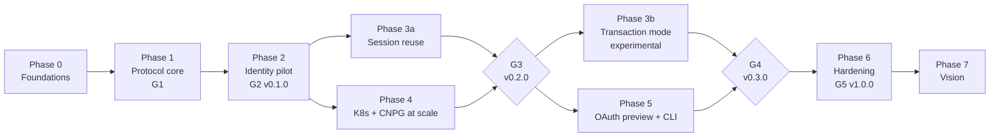

# pgbearer — Implementation Plan & Roadmap

> Status: **implementation in progress.** Foundations, the wire codec, TLS and
> token validation are implemented. Pool, session, policy and the server are
> next. The roadmap was re-sequenced on 12 October 2026 after the external
> design audit. See the [audit response](docs/reviews/2026-10-09-audit-response.md)
> for verdicts, the issues found, and the decisions behind this plan.
>
> Releases are gated by **evidence** ([release gates](#6-release-gates)), not
> dates. Durations are re-estimated after the identity-pilot spike. Bare
> section references (§) point to ARCHITECTURE.md; links to sections of this
> plan are written out.

## Contents

1. [Vision](#1-vision)
2. [Guiding principles](#2-guiding-principles)
3. [Scope of v1.0](#3-scope-of-v10)
4. [Success criteria](#4-success-criteria)
5. [Roadmap at a glance](#5-roadmap-at-a-glance)
6. [Release gates](#6-release-gates)
7. [Phases in detail](#7-phases-in-detail)
8. [Cross-cutting workstreams](#8-cross-cutting-workstreams)
9. [Compatibility matrix](#9-compatibility-matrix)
10. [Risks and mitigations](#10-risks-and-mitigations)
11. [Decisions](#11-decisions)
12. [ADR backlog](#12-adr-backlog)
13. [Definition of Done](#13-definition-of-done)

---

## 1. Vision

> *Access to PostgreSQL in Kubernetes should be granted, reviewed and revoked
> in the identity provider, not through passwords spread across wikis,
> vaults and CI variables.*

pgbearer is an identity-aware PostgreSQL gateway, written in Rust. It accepts
OIDC tokens from people (Entra ID, Keycloak, …) and from workloads
(Kubernetes ServiceAccounts, Azure Workload Identity, GitHub Actions). It maps
them through a central policy to least-privilege PostgreSQL roles and connects
to CloudNativePG clusters without shared superusers or long-lived passwords.
Every connection is audited with the real identity.

It improves on [gprxy](https://github.com/sathwick-p/gprxy) in correctness
(full protocol support, role enforcement on the data path), security (TLS
everywhere, default deny, no backend key leakage), operability
(Kubernetes-native, CNPG-aware, observable) and future-proofing (protocol 3.2,
PostgreSQL 18 OAUTHBEARER, direct TLS/SNI routing). See ARCHITECTURE §2.

## 2. Guiding principles

1. **Correctness before features.** The relay must be protocol-correct for
   every supported driver before any optimisation or extra feature.
2. **Secure by default.** TLS required for tokens, default deny, fail closed
   (including on *unknown* data), no secrets in logs, no unsafe code in
   pgbearer's own crates.
3. **The database stays in charge of privileges.** pgbearer decides *which
   role* you get. PostgreSQL decides *what the role can do*. pgbearer checks
   what a role can *reach* as defence in depth.
4. **Bounded promises.** Every guarantee has a stated bound: revocation and
   expiry deadlines, per-replica limits, an "outcome unknown" when a request
   was in flight. pgbearer never claims what it cannot measure.
5. **Kubernetes-native, not Kubernetes-only.** Every feature also works with a
   static config file outside Kubernetes. Kubernetes integrations are
   additions.
6. **Observable by design.** Every decision is explainable from metrics, logs
   and audit events.
7. **Small, well-bounded crates, and no more of them than needed.** The
   existing crates are each testable in isolation. New crates are added only
   when a boundary has been demonstrated.
8. **Measure, then optimise.** Performance numbers are goals until measured
   with a written method.

## 3. Scope of v1.0

**In scope**

- Full PostgreSQL protocol relay (3.0 and 3.2): simple and extended query,
  pipelining, COPY, LISTEN/NOTIFY, cancellation, SSLRequest and direct TLS.
- Client authentication: token as password and SASL OAUTHBEARER.
- Issuers: generic OIDC, Entra ID (delegated and application token
  profiles), Kubernetes (JWKS; TokenReview optional), GitHub Actions. Several
  issuers at the same time.
- Declarative policy (grants and deny rules) with three-valued evaluation,
  per-replica limits, session lifetime and bounded revocation.
- Backend login as the mapped role: certificate + `pg_ident` (strategy A),
  per-role certificates (B), per-role passwords (C). Role reachability check.
- Client startup settings forwarded to the backend (exact session defaults).
- Pooling: one backend per client session by default; opt-in reuse keyed by
  startup profile. Transaction mode only if gate G4 passes before 1.0;
  otherwise it stays experimental.
- CloudNativePG: service discovery, CA handling, failover-aware sessions and
  pools, examples.
- Kubernetes: Helm chart, probes, drain, HPA, PDB, NetworkPolicy,
  ServiceMonitor, alerts, dashboard. Authenticated cancel forwarding between
  replicas.
- Observability: Prometheus metrics, JSON logs, OTLP traces, audit stream
  with lease and physical-connection evidence.
- `pgbearerctl`: login (PKCE + device code), token, connect, explain, doctor,
  admin.
- Supply chain: signed multi-arch images, SBOM, provenance.

**Out of scope for v1.0** (candidates for Phase 7)

- Personal roles / JIT role provisioning, CRD-based policy, query-level
  policy, read/write splitting, Graph group-overage resolver, token
  introspection for opaque tokens, admin SQL console, external policy engines,
  fleet-wide quotas, replication connections, sharding (never).

## 4. Success criteria

All numbers below are **goals** until measured with the method in §18 of
ARCHITECTURE. A release claims only what its evidence shows.

| Area | Criterion (measured in CI or release checklist) |
|---|---|
| Compatibility | 100 % pass rate in the pinned client compatibility suite ([compatibility matrix](#9-compatibility-matrix)) for every release, with documented exclusions. |
| Correctness | No known protocol desyncs. Relay-state property tests and fuzzers run ≥ 1 h per release without new failures. |
| Security | No high or critical findings open at release. Independent review before 1.0. Threat model updated each minor release. |
| Revocation | Local policy revocation completes within config propagation + 60 s on every replica, including continuously active sessions (V11). Expired tokens end within grace + hard timeout (V12). |
| Performance (goals) | Session-mode overhead p99 < 100 µs per round trip on the reference setup. ≥ 90 % of direct `pgbench -S` TPS at 64 clients. Published incremental memory per idle client and per attached session. |
| Availability | New connections recover within a bounded time after a CNPG switchover. In-flight requests get a precise error (`08007` when the outcome is unknown). No automatic SQL replay. A pgbearer rolling upgrade fails no new connections. |
| Operability | Install to first authenticated `psql` session in < 15 minutes following the CNPG + Entra ID guide. |

## 5. Roadmap at a glance

| Phase | Theme | Gate → release | State |
|---|---|---|---|
| 0 | Foundations: workspace, CI, chart skeleton, ADRs | — | Mostly done |
| 1 | Protocol core: TLS-terminating relay with explicit relay state | G1 → `v0.1.0-alpha` | wire ✔, tls ✔; relay next |
| 2 | Identity pilot (MVP): 1:1 sessions, auth, policy, revocation, audit | G2 → `v0.1.0` | auth ✔; policy, pool, session next |
| 3a | Opt-in session reuse | G3 → `v0.2.0` | — |
| 4 | Kubernetes and CloudNativePG at scale | G3 → `v0.2.0` | Chart and examples drafted |
| 3b | Transaction mode (experimental) | G4 → `v0.3.0` | ADR-010 first |
| 5 | Native OAuth (preview) and `pgbearerctl` | G4 → `v0.3.0` | OAUTHBEARER server code exists |
| 6 | Hardening, performance, GA | G5 → `v1.0.0` | — |
| 7 | Beyond 1.0 (vision) | `v1.x` | — |

Phases 3a and 4 can run in parallel with two engineers, as can 3b and 5.
Phase 3b may slip past 1.0 without blocking it: transaction mode then ships
as experimental.

---

## 6. Release gates

Adopted from the audit's validation plan (V01–V48) with the changes in the
[audit response §6](docs/reviews/2026-10-09-audit-response.md#6-validation-plan-and-release-gates).
A failed invariant blocks the affected feature. A scenario is not "passed" by
documenting a known security failure. Evidence is stored as CI artifacts and a
release manifest.

| Gate | Release | Scope | Required evidence |
|---|---|---|---|
| G0 — design ready | — | Before security-boundary code | Contracts for startup profile, relay state, cancel ownership, role reachability, token profiles and revocation written (ADR-005, 014–018); owner decisions accepted; PostgreSQL 16+ baseline |
| G1 — protocol prototype | `v0.1.0-alpha` | Development only | Golden transcripts; bounded framing; relay-state property tests; local cancel; malformed input; V32–V35 for session mode; no production auth stub |
| G2 — identity pilot | `v0.1.0` | 1:1 sessions, no reuse; one real IdP; CNPG | V01, V03, V08–V19, V24, V27, V32–V37, V39, V43, V47, V48 |
| G3 — reuse and replicas | `v0.2.0` | Opt-in reuse; several replicas | V02, V04–V07, V20–V28, V38, V40–V42, V44, V45 |
| G4 — experimental extensions | `v0.3.0` | Transaction mode and native OAuth, separately | V29–V35 plus a driver matrix in transaction mode; V46–V47 for OAuth; published per-mode exclusions |
| G5 — production qualification | `v1.0.0` | Stable declared feature set | All applicable scenarios pass on pinned versions; independent security review; soak and chaos evidence; runbooks; signed, reproducible artifacts; no unresolved high design risks |

---

## 7. Phases in detail

### Phase 0 — Foundations

**Goal:** a working skeleton that makes every later change safe and quick to
review.

- [x] Cargo workspace (edition 2024, resolver 3), crate layout from §5,
      `unsafe_code = "forbid"`, `missing_docs` and Clippy lints, centralised
      dependency versions.
- [x] CI (GitHub Actions): `fmt`, `clippy -D warnings`, tests against real
      PostgreSQL, `cargo-deny`, container build, Helm lint.
- [x] Container image (distroless, non-root), Helm chart skeleton, CNPG
      example, guides.
- [x] Licence file: Apache-2.0 ([decision D1](#11-decisions)).
- [x] Rename the GitHub repository to
      [`egkristi/pgbearer`](https://github.com/egkristi/pgbearer)
      ([decision D2](#11-decisions)).
- [ ] Pinned `rust-toolchain.toml`, an MSRV job, SHA-pinned actions with
      Renovate or Dependabot, minimal workflow permissions, untrusted PR jobs
      without secrets.
- [x] CI baseline PostgreSQL 16/17/18; drop 14
      ([decision D8](#11-decisions)).
- [ ] Non-blocking PostgreSQL 19 beta job.
- [ ] `SECURITY.md` (disclosure process), `CONTRIBUTING.md`, issue and PR
      templates.
- [ ] `docs/adr/` with template; ADR-001 … ADR-004 recorded; ADR-005 and
      ADR-014 … ADR-019 accepted ([ADR backlog](#12-adr-backlog)).
- [ ] Threat model v0 (`docs/threat-model.md`), starting from the audit's
      appendix A, with the new issues in the audit response.
- [ ] Dev environment: `just` targets; `kind` config with the CNPG operator.

**Exit criteria (G0):** CI green; ADRs accepted; owner decisions recorded.

---

### Phase 1 — Protocol core

**Goal:** a protocol-correct, TLS-terminating, full-duplex relay to a static
backend, with an explicit relay state machine. Client authentication is a
development-only stub, behind the `dev-insecure` cargo feature and excluded
from release builds.

**`pgbearer-wire`** (implemented, 93 tests)
- [x] Startup-phase decoding: StartupMessage (3.0/3.2), SSLRequest,
      GSSENCRequest, CancelRequest, direct-TLS detection; PROXY v2.
- [x] Header-only framing for regular messages; streaming of large bodies.
- [x] Typed views and encoders for the messages pgbearer inspects or
      generates.
- [x] Pre-auth limits (startup ≤ 10 000 bytes, password ≤ 16 KiB).
- [x] Poison body methods after cancellation (audit response N9); reject
      NUL and oversize packets in the startup encoder (N35, N34).
- [ ] Duplicate-key helpers (N36).
- [ ] Lazy, adaptive buffers that shrink when idle (N25).
- [ ] cargo-fuzz targets for every decoder.

**`pgbearer-tls`** (implemented, 57 tests)
- [x] rustls server: SSLRequest upgrade, direct TLS with ALPN `postgresql`,
      SNI capture; coherent hot reload with last-good fallback and expiry
      metric.
- [x] rustls client to backend: `verify-full` / `verify-ca` / `require`,
      client certificates, separate verify name.

**`pgbearer-session` (1:1 relay)**
- [ ] `RelayState` (§7.3): expected ReadyForQuery count, open extended
      batch, COPY state, partial frames, writer flush, uncertainty flags;
      `quiescent`, `idle_safe_point` and `reusable` predicates.
- [ ] Two-pump relay; control events act at frame boundaries; only hard
      deadlines drop the pumps; no injected message mid-frame.
- [ ] Backend authentication client: SCRAM-SHA-256 (+PLUS), certificate.
- [ ] Startup profile: normalised client settings forwarded in the backend
      StartupMessage (§7.4); hard deny-list.
- [ ] Proxy-generated cancel keys; lease-ownership cancel registry
      (ADR-005); single replica.
- [ ] Protocol version negotiation (3.0 ↔ 3.2 translation).
- [ ] PROXY protocol v2 only from trusted proxies.

**`pgbearer` binary**
- [ ] Config loading and validation; admin HTTP (`/livez`, `/readyz`,
      `/metrics`); admin mutations on a Unix socket.
- [ ] Graceful shutdown and drain (§4.3).

**Testing**
- [ ] Golden transcripts (psql, libpq pipeline mode, pgjdbc, Npgsql, pgx,
      psycopg 3, asyncpg) against PostgreSQL 16 and 18.
- [ ] V32–V35 for session mode: pipelines, unsynced batches, extended COPY,
      FunctionCall, partial frames, slow readers, drain or idle during a
      pipelined query, hard deadline mid-DataRow.
- [ ] Property tests of `RelayState` over random interleavings
      (over-counting allowed, under-counting never).
- [ ] Benchmark harness (instruction counts on hosted CI).

**Exit criteria (G1):** the golden transcripts and V32–V35 pass against
PostgreSQL 16 and 18. No desync under fuzzed sequences. →
**`v0.1.0-alpha`** (dev-only image).

---

### Phase 2 — Identity pilot (MVP)

**Goal:** the first useful release. People and workloads log in with tokens
and get the right role on a CNPG cluster: one backend connection per client
session, bounded revocation, audit evidence.

**`pgbearer-auth`** (implemented, 110 tests)
- [x] Issuer registry, exact `iss` selection, discovery with exact issuer
      match, JWKS cache (single-flight, rate-limited, atomic replacement,
      bounded staleness), validation pipeline, claim mapping, presets.
- [x] Token as password on TLS listeners; OAUTHBEARER server exchange.
- [ ] Explicit token profiles: Entra `delegated` and `application`; generic
      OIDC kind `Unknown` unless a profile attests it; reject `nonce` (ID
      tokens).
- [ ] `max_token_lifetime` per provider; same-origin redirects;
      `revoked_key_ids`; `key_id` on `Identity`.
- [x] Kubernetes audience validation (reject the API server audience).
- [x] GitHub preset: tenant `repository_owner_id`.

**`pgbearer-core` / `pgbearer-config`**
- [x] One claim lookup: literal name, then dotted path, then JSON Pointer;
      claim names validated at load.
- [x] Experimental flag for transaction mode; trusted proxies; issuer
      required on grants; lifetime overrides only shorten; startup-packet
      cap; grace 60 s.
- [ ] Remaining settings from the audit response §9.2: reuse, expiry hard
      timeout and revocation deadline, `acknowledged_role_risks`,
      keepalives, per-replica limit names, token profiles.

**`pgbearer-policy`**
- [ ] Three-valued predicates; deny fires on Unknown unless
      `on_unknown: ignore`.
- [ ] Order-independent merge: every limit enforced, minimum lifetime,
      strictest expiry mode, conflicting default roles denied.
- [ ] Issuer required on grants; overrides only tighten.
- [ ] Table tests and permutation property tests (V48).

**Backend identity and pool (no reuse)**
- [ ] Strategies A, B and C.
- [ ] Schema-qualified safety and discovery query: role reachability (ADR-015),
      physical endpoint, target suitability, database session id.
- [ ] Startup profile in the backend StartupMessage; packet size check;
      client-caused startup errors passed through.
- [ ] Connection limits per backend, per replica; acquire timeout; bounded
      backoff with jitter; keepalives; exact SSLRequest handling.

**Session lifetime and revocation (§12, ADR-014)**
- [ ] Policy snapshots with generations; re-evaluation of active sessions.
- [ ] Expiry grace 60 s + hard 120 s; revocation hard 60 s;
      `terminate: immediate` for emergency denies.
- [ ] Cancel before forced close; phase-aware termination codes (`08007`
      when in flight).

**Audit (`pgbearer-audit`)**
- [ ] Envelope `seq`/`instance_id`; `backend.connected`, `session.attached`
      (with lease and physical ids, generation), `session.detached`,
      `session.revoked`, `config.applied`; untrusted labels.
- [ ] Attach evidence enqueued before work; non-blocking bounded queue with
      drop metrics.

**Deployment (basic)**
- [x] Helm: directory config mount; checksum only over restart-required
      sections; PDB `maxUnavailable: 1`; `minReadySeconds`; configurable
      `maxSurge`.
- [ ] Helm: projected token for issuer discovery.
- [x] Examples within the connection budget; schema-scoped grants; HBA
      database column; PROXY off; GitHub claims.

**Testing**
- [ ] Mock-issuer tests for every validation rule (done for the existing
      rules), plus token profiles, lifetime cap and key purge.
- [ ] Real IdPs: Keycloak and Kubernetes SA tokens on kind (CI), Entra ID
      (nightly, test tenant, federated credentials).
- [ ] G2 scenarios: V01, V03, V08–V19, V24, V27, V32–V37, V39, V43, V47, V48.

**Exit criteria (G2):** a developer can follow the kind example and connect
with an IdP token as the mapped role. Denials and revocations are explained in
the audit log. All G2 scenarios pass on PostgreSQL 16 and 18. →
**`v0.1.0` (MVP)**.

---

### Phase 3a — Opt-in session reuse

**Goal:** fewer backend connects for workloads that open many short
sessions, without weakening isolation.

- [ ] `pool.reuse: same_identity | same_role` (default `none`); key
      `(generation, backend, database, role, startup profile[, identity])`.
- [ ] Release by `ReleaseVerdict` only; verified `DISCARD ALL` (exact
      response); acquire-time drain of unsolicited messages; discard when in
      doubt.
- [ ] Generations and `retire(selector, mode)`; purge per backend; pending
      restart metric.
- [ ] Role-risk set stored per connection and checked on every acquire;
      `role_check_ttl`.
- [ ] `pool.max_pools`; pools created after a successful connect; wildcard
      database label.
- [ ] Tests: V02 with reuse enabled; V04/V05 cancel races; V20/V21; soak.

**Exit criteria:** the G3 reuse scenarios pass.

---

### Phase 4 — Kubernetes and CloudNativePG at scale

**Goal:** production-grade operation in Kubernetes with first-class CNPG
support and several replicas.

- [ ] Watch CNPG `Cluster` resources; on a `currentPrimary` change, bump the
      read-write generation and close old-generation read-write sessions
      immediately (§10.6). The code starts in the binary crate.
- [ ] `cnpg` backend kind: service resolution, CA handling, verify name
      `<svc>.<ns>.svc`.
- [ ] Kubernetes issuer in optional **TokenReview** mode with a bounded cache.
- [ ] Multi-replica cancel forwarding: authenticated peers (mTLS), bounded
      fan-out, headless Service with `publishNotReadyAddresses`, peer port
      open until the last session ends (ADR-005).
- [ ] Routing by SNI for many clusters behind one load balancer.
- [ ] Helm chart v1: HPA, PDB, topology spread, NetworkPolicy (clients,
      peers, egress), ServiceMonitor, PrometheusRule, dashboard, values
      schema, configurable `maxSurge`, `connectionBudget` render check.
- [ ] Runtime budget metrics (`pgbearer_backend_instance_slots`), limit
      gauges and alerts.
- [ ] Examples and guides: CNPG + cert-manager (strategy A), `DatabaseRole`
      `clientCertificate` (strategy B), pod selectors, Entra ID (delegated
      and application profiles, AKS Workload Identity), GitHub Actions trust,
      capacity worksheet.
- [ ] Runbooks: unknown commit outcomes, key compromise, certificate expiry,
      pool exhaustion, policy convergence, audit outage, loss of the API
      watch.
- [ ] e2e on kind (CI): switchover and isolated primary, rolling update with
      slow drain, node drain under the PDB, pod kill, certificate rotation,
      config reload, all under load (V25, V26, V36–V38, V41, V42).

**Exit criteria (G3, with Phase 3a):** the G3 scenarios pass. An install from
the guide reaches a first session in < 15 minutes. → **`v0.2.0`**.

---

### Phase 3b — Transaction mode (experimental)

**Goal:** multiplexing for high-concurrency workloads, honestly gated.

- [ ] ADR-010 accepted **before** any code.
- [ ] `experimental.transaction_pooling: true` required; validation rejects
      transaction mode otherwise. No silent fallback.
- [ ] Identity-scoped pools by default; role-scoped sharing only by explicit
      opt-in.
- [ ] Detach only at the quiescent point with status `I`; discard on cancel,
      FATAL or protocol error.
- [ ] Pin the client on named statements or portals, GUC drift, LISTEN,
      extended COPY or uncertain state; `on_named_statement: error | pin`.
- [ ] Later, behind evidence: prepared-statement virtualisation (ordered
      response queue, key including parameter types, reference counts, byte
      budgets).
- [ ] Tests: V29–V35 and a driver matrix (pgjdbc, asyncpg, pgx, Npgsql,
      psycopg 3 pipeline mode); `pgbench` 1 000 clients against 50 backends as
      a measurement.

**Exit criteria (G4 for transaction mode):** the scenarios pass with
published exclusions. Otherwise the feature stays experimental.

---

### Phase 5 — Native OAuth (preview) and client tooling

**Goal:** a smooth experience for people, including password-free psql 18.

- [x] SASL **OAUTHBEARER** server exchange (RFC 7628) bound to a configured
      provider per listener.
- [ ] Interop tests with libpq/psql 18 device flow against Keycloak and
      Entra ID; the discovery connection takes no lease (V46).
- [ ] `pgbearerctl`:
  - [ ] `login`: authorization code + PKCE (loopback) and device code; token
        cache in the OS keychain; refresh tokens.
  - [ ] `token`; `connect` / `psql` (token through a `0600` passfile, never
        argv).
  - [ ] `explain` (local policy evaluation) and `doctor` (TLS, issuer,
        token claims, role reachability report, definer functions).
  - [ ] `admin reload | drain | purge` over the local admin socket.
  - [ ] Distribution: Homebrew, Scoop, winget, `.deb`/`.rpm`, `cargo install`,
        Krew.
- [ ] Driver guide: token callbacks per new physical connection (Npgsql,
      pgx, asyncpg, psycopg, JDBC), app-pool lifetime shorter than the token
      lifetime (V47).

**Exit criteria (G4 for OAuth):** psql 18 connects through the device flow
against Entra ID without extra tools. `pgbearerctl` works on Linux, macOS and
Windows. → **`v0.3.0`**.

---

### Phase 6 — Hardening, performance and GA

**Goal:** something you can bet production on.

- [ ] Independent security review / penetration test. Fix all high and
      critical findings.
- [ ] Threat model v1. `SECURITY.md` with response SLAs.
- [ ] Continuous fuzzing.
- [ ] Performance measured with a written method (hardware, both TLS legs,
      key type, resumption, warm/cold state, p50/p99/p99.9, error rate,
      paired with direct PostgreSQL and PgBouncer). Sizing guidance.
- [ ] FIPS build variant (`aws-lc-rs` FIPS).
- [ ] Release engineering: reproducible builds, SBOM, cosign keyless
      signing, SLSA provenance, multi-arch, signed OCI Helm chart.
- [ ] Configuration API `v1` (stable). Deprecation policy. Upgrade guide.
- [ ] Documentation site: concepts, guides, reference (config, metrics,
      audit schema), runbooks.
- [ ] Support policy with a release-specific tested matrix.

**Exit criteria (G5):** all applicable scenarios pass on pinned versions. No
open high or critical issues. → **`v1.0.0`**.

---

### Phase 7 — Beyond 1.0 (vision backlog, ordered by expected value)

1. **Personal roles / JIT provisioning.** One PostgreSQL role per identity,
   created on first login (or ahead of time via SCIM-like sync), with group →
   role memberships reconciled and inactive roles removed. `current_user` is
   the human, which gives exact pgaudit attribution and RLS on the real
   identity. Optional output as CNPG `DatabaseRole` resources for GitOps.
2. **CRDs and controller.** `PgBearerRoute` and `PgBearerAccessPolicy` so
   application teams can own their access policy next to their CNPG cluster,
   with RBAC-delegated and validating admission. The CRD API group needs a DNS
   domain the project controls (to be registered).
3. **Just-in-time elevated access.** Time-bound grants (for example "owner role
   for 1 h") requested via CLI or chat, approved by a second person, fully
   audited, auto-expiring. Break-glass with mandatory reason.
4. **Query-level policy** (`sql-inspect`): read-only enforcement, DDL blocking,
   statement allow-lists per grant, row-limit guards for humans on production.
   Diagnostics, never the security authority for functions.
5. **Read/write splitting** to CNPG `-ro` with lag awareness.
6. **Entra ID groups-overage resolver** through Microsoft Graph using
   Workload Identity, with caching.
7. **Opaque tokens** via RFC 7662 introspection. **DPoP / mTLS-bound tokens**
   (RFC 9449 / RFC 8705) for proof-of-possession.
8. **Admin console** over the PostgreSQL protocol (`SHOW POOLS`,
   `SHOW SESSIONS`, `KILL`), PgBouncer-style.
9. **Pluggable policy engines** (CEL expressions, OPA, Cedar) behind the
   `PolicyEngine` trait.
10. **Fleet-wide connection budget and quotas** across replicas (coordination
    via Kubernetes Leases or gossip) with an explicit failure policy.
11. **Multi-cluster / multi-region** routing and failover-aware DNS.

---

## 8. Cross-cutting workstreams

| Workstream | Practices |
|---|---|
| **Testing** | Unit tests per crate. Golden protocol transcripts. Relay-state property tests. The pinned compatibility suite ([compatibility matrix](#9-compatibility-matrix)) is a release gate. Integration tests against real PostgreSQL. kind e2e with CNPG. Fuzzing. Soak and chaos tests. A malicious authenticated client next to a legitimate one in isolation tests. |
| **Security** | Threat model kept current. `cargo-deny` on every PR. Dependency review for new crates (maintenance, `unsafe`, licence). No secrets in logs, argv or audit payloads; environment exposure documented where unavoidable. Security review per phase on auth, policy and session code. |
| **Documentation** | Docs live next to code. Every config field documented in the schema. A guide per integration. ADR for every significant decision. CHANGELOG (Keep a Changelog). Published limitations next to every guarantee. |
| **Release engineering** | SemVer. Signed artifacts. `main` always releasable. Experimental features behind `experimental.*` config and validation errors when used without the flag. |
| **Performance** | Instruction-count benchmarks on hosted CI; wall-clock latency, throughput and soak on a dedicated runner with a stored run manifest. Memory reported as incremental per idle client, per attached session, fixed RSS, kernel socket memory and backend memory. |
| **Provenance** | pgbearer is an independent implementation. No upstream code or fixtures are copied. Upstream comparisons cite pinned commits. |

## 9. Compatibility matrix

Each release publishes the exact tested versions (image digests, driver
versions, OAuth build flags). Floating "latest" jobs are discovery only.

**Client drivers** (each run against every backend version):

| Driver | Versions | Notable features exercised |
|---|---|---|
| libpq / psql | 16, 17, 18 | Pipeline mode, `sslnegotiation=direct` (17+), protocol 3.2 and OAUTHBEARER (18) |
| pgjdbc | 42.7.x | Extended protocol, server-prepared statements, COPY API |
| Npgsql | 8.x, 9.x | Startup `search_path`/`TimeZone`, prepended `DISCARD ALL`, binary COPY |
| pgx (Go) | v5 | Pipelining, `QueryExecModeCacheStatement` |
| psycopg | 3.x | Pipeline mode, server-side cursors |
| asyncpg | pinned | Heavy prepared-statement use, `server_settings` |
| node-postgres | pinned | Simple and extended protocol |
| tokio-postgres / sqlx | pinned | Pipelining, binary formats |

Known exclusions: clients that require channel binding or SCRAM-only
authentication cannot use token-as-password (they never send a cleartext
password); replication connections are rejected.

**Backends:** PostgreSQL 16, 17 and 18 (CNPG images), plus 19 beta as a
non-blocking job. PostgreSQL 14 reaches end of support on 12 November 2026
and is not supported; 15 is not tested.
**Kubernetes and CloudNativePG:** the versions the current CNPG releases
support, recorded with dates and sources in each release manifest. The
`DatabaseRole` features require CNPG 1.30+.
**IdPs:** Keycloak and Kubernetes (CI). Entra ID (nightly). Okta, Auth0,
Dex and GitHub Actions (preset tests with recorded discovery documents and
keys, plus periodic live checks). IdPs that issue opaque access tokens are
out of scope until Phase 7.

## 10. Risks and mitigations

| Risk | Impact | Likelihood | Mitigation |
|---|---|---|---|
| Protocol edge cases (pipelining, COPY, error recovery) cause desyncs or premature release | High | Medium | Explicit `RelayState` with conservative predicates; golden transcripts; property tests; fuzzing; broad driver matrix from Phase 1. |
| Startup defaults diverge from a direct connection | High | Medium (without forwarding: certain) | Forward the startup profile in the backend StartupMessage; V01–V03 in G2. |
| Cross-borrower leakage once reuse exists | High | Medium | No reuse by default; profile-keyed opt-in reuse; poison-and-discard on cancel; verified reset; G3 evidence. |
| Transaction-mode semantics surprise users | Medium | High | Experimental flag; identity-scoped pools; pin or error on named statements; ADR-010 and G4 evidence first. |
| Revocation does not converge (stalled rollout, IdP outage) | High | Medium | Directory-mounted config with hot reload; denylist file; generations; hard deadlines; convergence metric. |
| Mapped role reaches privileges beyond its attributes | High | Medium | Reachability check with acknowledged risks; TTL recheck; `pgbearerctl doctor`; least-privilege examples. |
| Unknown commit outcomes after failover or forced close | High | Medium | `08007`, never a retry-safe code while in flight; no replay; runbook and application guidance. |
| Token lifetime vs long sessions (disconnects every ~1 h) | Medium | High | `terminate_when_idle` with a hard deadline; app pools reconnect with fresh tokens; driver callback guide. |
| Entra ID specifics (token classes, overage, guests) | Medium | Medium | Explicit token profiles; deny on unknown; nightly real-tenant tests; guide with a manifest checklist. |
| Connection budget exceeded under HPA and rollouts | High | Medium | Per-instance worksheet; chart render check; paced rollouts; runtime slot metrics and alerts. |
| A compromised proxy can log in as any `pgbearer_login` member | High | Low | Reachability checks; pod-selector HBA pinning with reject guard; NetworkPolicy; least-privilege roles; short-lived certificates; audit. |
| Memory exhaustion at high connection counts | Medium | Medium | Lazy buffers; consistent defaults; cgroup-aware startup warning; soak tests. |
| Dependency or supply-chain vulnerability | High | Low | cargo-deny, minimal dependencies, pinned versions and actions, signed releases, SBOM. |
| Scope creep (sharding, query rewriting) | Medium | Medium | Explicit non-goals; gates; Phase 7 backlog gated by ADRs. |
| CNPG API changes | Medium | Low | Watch only stable fields; version-tolerant deserialisation; e2e against supported CNPG releases. |

## 11. Decisions

Decided items are marked ✅. The others are **proposed defaults** from the
[audit response §8](docs/reviews/2026-10-09-audit-response.md#8-owner-decisions)
(OD numbers in brackets), implemented unless the project owner decides
otherwise.

| # | Decision | Options | Proposal |
|---|---|---|---|
| D1 | Licence | — | ✅ **Decided: Apache-2.0** (see [LICENSE](LICENSE)). Patent grant, CNCF-friendly. pgbearer is an independent implementation. gprxy (MPL-2.0) was read for the design review at commit `02777248aead399f891b5a5dbd261fd25349b674`, but no gprxy code or fixtures were copied, so MPL-2.0 imposes no obligations. Dependency licences are checked by `cargo-deny`. |
| D2 | Project and binary name | — | ✅ **Decided: `pgbearer`** (replaces the working name `pgproxy`, which several other projects use). The name means "present a bearer token, get a least-privilege PostgreSQL role", and it follows the pgbouncer/pgbackrest naming convention. It was chosen from 34 vetted candidates; the runner-up was `keyphant`. It is free on crates.io, npm, PyPI and Docker Hub, and no same-name project, product or company was found. Before 1.0, run a formal trademark search: "BEARER" is a US trademark of Bearer SAS (Cycode) for a code-security scanner, a different product category, and "bearer" itself is the generic RFC 6750 term. |
| D3 | Default `user_semantics` | `role`, `identity`, **`auto`** | **`auto`**: an entitled role name selects that role; the identity's own name or `*` selects the default role. Conflicting default roles across matching grants are denied. |
| D4 | Default pool mode and reuse | **`session`** + reuse **`none`**; `transaction` | **Session mode, one backend per client session** [OD5]. Reuse is opt-in after G3. Transaction mode requires `experimental.transaction_pooling` [OD6]. |
| D5 | Token expiry | `terminate`, **`terminate_when_idle`** | **`terminate_when_idle`, grace 60 s, hard timeout 120 s, 12 h max lifetime; `ignore` removed** [OD9]. |
| D6 | Config format | **YAML** (with JSON Schema), TOML | **YAML**: Kubernetes-native; the schema gives editor validation. |
| D7 | How pgbearer reads CNPG Secrets and config | **Volume mounts (directories)**, API watch | **Directory mounts** for v1, never `subPath`; API watch as an option in Phase 4. |
| D8 | Minimum supported PostgreSQL | 14, **16** | **16** [OD2]. 14 is end-of-life on 12 Nov 2026; strategy A and the reachability semantics need 16. |
| D9 | Docs language | — | ✅ **Decided: English.** |
| D10 | Client startup settings | **forward in StartupMessage**, `SET` replay | **Forward**, with a hard deny-list and backend validation of the rest [OD3, OD4]. |
| D11 | Cancel rule | **poison-and-discard**, timer | **Poison-and-discard**, endpoint pinned [OD7]. |
| D12 | Role risks | — | **Block** superuser, createrole, replication, bypassrls, server files, admin option, predefined admin roles unless acknowledged; **warn** on owner, createdb, read-all [OD8]. |
| D13 | Revocation | — | **Hard 60 s** for local policy; `terminate: immediate` for emergency denies [OD9]. |
| D14 | Unknown data in deny rules | **fail closed**, fail open | **Fail closed**, per-rule `on_unknown: ignore` [OD11]. |
| D15 | Unknown outcome code | **`08007`**, `08006` | **`08007`** [OD13]. |
| D16 | Quota scope | **per replica**, fleet-wide | **Per replica**, named that way [OD16]. |
| D17 | Trust planes | — | PROXY off by default with `trusted_proxies`; admin mutations on a Unix socket; peers with mTLS [OD19, OD20]. |
| D18 | Audit delivery | **best effort** → required | **Best effort** with gap metrics in v0.1; **required** class before a multi-user pilot [OD18]. |

## 12. ADR backlog

| ADR | Title | Phase | Status |
|---|---|---|---|
| 001 | Rust + Tokio as language and runtime | 0 | to record |
| 002 | Own wire codec (header-only, streaming) instead of `pgwire`/`tokio-postgres` | 0 | to record |
| 003 | Terminate client authentication at the proxy; never pass through | 0 | to record |
| 004 | Backend login as the mapped role (cert + `pg_ident`), not `SET ROLE` | 0 | to record |
| 005 | Cancellation ownership: proxy keys, poison-and-discard, endpoint pinning, peer forwarding | 1 | proposed (audit appendix C, amended) |
| 006 | Configuration format, schema and hot-reload semantics (restart-required sections, generations) | 1 | to write |
| 007 | JWT library and JWKS cache semantics | 2 | to record |
| 008 | Policy model v1 (grants, deny, user semantics, three-valued evaluation, merge rules) | 2 | to write |
| 009 | Audit event schema v1, ids and delivery classes | 2 | to write |
| 010 | Transaction pooling and prepared-statement virtualisation | 3b | must precede code |
| 011 | CNPG integration: watch vs poll, Secret access, old-primary sessions | 4 | to write |
| 012 | OAUTHBEARER listener selection | 5 | to write |
| 013 | io_uring: deferred until benchmarks justify it | 6 | to write |
| 014 | Session revocation and expiry deadlines | 2 | proposed (audit appendix D, amended) |
| 015 | Role reachability contract | 2 | to write |
| 016 | Startup profile forwarding | 1 | to write |
| 017 | Relay state and safe release | 1 | to write |
| 018 | Token profiles (Entra delegated/application, OIDC, Kubernetes, GitHub) | 2 | to write |
| 019 | Trust planes: PROXY, admin, peers | 2 | to write |

## 13. Definition of Done

A change is done when:

- [ ] Code is reviewed, `fmt`/`clippy`/`deny` are clean, and there is no new
      `unsafe`.
- [ ] Unit tests cover the logic. The compatibility suite passes when protocol
      or session code changed. The gate scenarios it affects are updated.
- [ ] New config fields are in the schema with docs and defaults; count
      limits say "per replica".
- [ ] New behaviour is observable (metric, log or audit event, as relevant).
- [ ] Security impact was considered (threat model updated if a trust boundary
      changed).
- [ ] Docs and CHANGELOG are updated. There is an ADR if the change is
      architectural.
- [ ] No regression > 10 % in instruction-count benchmarks on the hot path.
