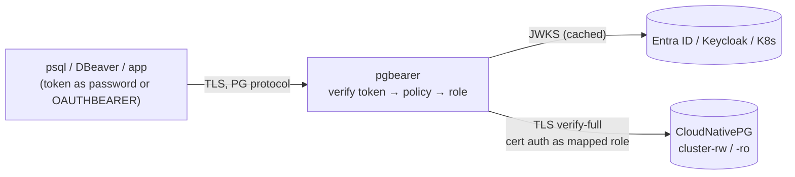

# pgbearer

**An identity-aware PostgreSQL gateway for Kubernetes, written in Rust.**
Log in to PostgreSQL with your OIDC identity (Microsoft Entra ID, Keycloak,
Okta, Kubernetes ServiceAccounts, GitHub Actions …). There are no database
passwords to hand out or rotate, and access is governed centrally. It is built
to run in front of [CloudNativePG](https://cloudnative-pg.io) clusters.

*Present a **bearer** token, get a least-privilege **PostgreSQL** role.*

> [!IMPORTANT]
> **Status: pre-alpha, not usable yet.** The wire codec, TLS and token
> validation are implemented and tested; the session relay, policy engine,
> backend pool and server are being built. Features below are *planned* and
> ship only when their evidence gates pass ([PLAN.md](PLAN.md#6-release-gates)).
> An external design audit (9 October 2026) and our
> [response](docs/reviews/2026-10-09-audit-response.md) shaped the current
> plan. The project was planned under the working name *pgproxy*.

---

## Why

Most teams still reach production databases with shared passwords kept in
wikis, vaults and CI variables. Offboarding is manual, audit logs show
`app_user`, and no one can say who ran which query.

pgbearer moves database access into your identity provider:

- **No database passwords for people.** Users connect with a short-lived
  OIDC access token, sent as the password or natively with psql 18's OAuth
  device flow.
- **Workload identity for apps and CI.** Pods use their Kubernetes
  ServiceAccount token. Pipelines use GitHub Actions OIDC. Azure workloads use
  Workload Identity.
- **Central, default-deny policy.** IdP app roles, groups and claims map to
  *least-privilege PostgreSQL roles*, per cluster and per database.
- **The database stays in charge.** pgbearer logs in **as the mapped role**
  (certificate authentication, no shared superuser). GRANTs, RLS and pgaudit
  work as usual.
- **Audit with real identities.** Every connection and decision is logged with
  issuer, subject, client and role, and can be joined with PostgreSQL logs.
  (Statement-level attribution to a person needs personal roles and pgaudit.)
- **Bounded revocation.** Removing access in policy ends active sessions
  within a configured deadline; expired tokens end sessions within a hard
  bound.
- **Kubernetes-native and CNPG-aware.** Helm chart, graceful drain, hot
  reload, failover-aware sessions. Cancellation across replicas is planned
  for Phase 4; until then a cancel only works when it reaches the replica that
  owns the session.

## How it works



1. The client connects over TLS and presents an access token.
2. pgbearer validates it (signature, issuer, audience, expiry, tenant, scopes)
   against the IdP's cached JWKS.
3. The policy decides which **PostgreSQL role** the identity may use on which
   cluster and database.
4. pgbearer uses a pooled backend connection, or opens one, *as that role*
   (certificate auth with `pg_ident`; no passwords), then relays the session
   with full protocol support. That includes the extended protocol,
   pipelining, COPY, LISTEN/NOTIFY and cancellation.

## What it will look like

**People with Entra ID: token as password, for clients that send a password
on request:**

```bash
export PGPASSWORD=$(az account get-access-token \
    --scope api://pgbearer/Database.Connect --query accessToken -o tsv)
psql "host=orders.db.example.com dbname=orders user=orders_readonly sslmode=verify-full"
```

Always verify the server certificate (`sslmode=verify-full`): the token is the
credential. `PGPASSWORD` is visible to your other processes while the shell
lives; `pgbearerctl psql` avoids that. Clients configured to require channel
binding or SCRAM only will not send a token as password.

**People with psql 18: native OAuth device flow, no extra tools (preview):**

```bash
psql "host=oauth.orders.db.example.com dbname=orders user=orders_readonly \
      sslmode=verify-full sslrootcert=system \
      oauth_issuer=https://login.microsoftonline.com/<tenant-id>/v2.0 \
      oauth_client_id=<client-id>"
```

**With the companion CLI:**

```bash
pgbearerctl login                       # browser (PKCE) or device code
pgbearerctl psql orders                 # fresh token + TLS settings, then exec psql
```

**Policy (excerpt):**

```yaml
policies:
  - name: orders-analysts
    when: { issuer: entra, roles_any: ["Orders.Analyst"] }
    grant: { backend: orders, databases: [orders], pg_roles: [orders_readonly] }

  - name: orders-api                    # in-cluster workload, no secrets at all
    when: { issuer: k8s, subject: "system:serviceaccount:orders:orders-api" }
    grant: { backend: orders, databases: [orders], pg_roles: [orders_app] }
```

## Planned features

| Area | Highlights |
|---|---|
| Protocol | PostgreSQL protocol 3.0 and 3.2 (PostgreSQL 18), direct TLS with ALPN/SNI (PostgreSQL 17+), extended protocol and pipelining, COPY, LISTEN/NOTIFY, cancellation; client startup settings preserved exactly |
| Authentication | Token as password; SASL OAUTHBEARER (preview); issuers: OIDC, Entra ID (delegated and application token profiles), Kubernetes (JWKS, optional TokenReview), GitHub Actions; several at once |
| Authorization | Default deny; grants and deny rules on roles, groups, scopes, tenant, subject and claims; unknown data never grants or bypasses a deny; per-replica limits; bounded revocation and token-expiry deadlines |
| Backend identity | Certificate + `pg_ident` (recommended), per-role certificates (CNPG `DatabaseRole`), per-role SCRAM passwords; role reachability checks |
| Connections | One backend session per client session by default; opt-in reuse; transaction mode as an experimental feature; bounded queues; failover-aware |
| Kubernetes | Helm chart, HPA/PDB/NetworkPolicy, hot reload, SNI routing for many clusters, CNPG `Cluster` watch, cancel forwarding between replicas |
| Observability | Prometheus metrics, OTLP traces, JSON logs, an audit event stream with lease and backend-session evidence |
| Supply chain | Rust with no `unsafe` in pgbearer's own code, fuzzed parsers, signed multi-arch images, SBOM, SLSA provenance |

Supported backends: PostgreSQL 16 and later. Tested drivers and known
exclusions are listed in the [compatibility matrix](PLAN.md#9-compatibility-matrix).

## Roadmap

| Release | Gate | Milestone |
|---|---|---|
| `v0.1.0-alpha` | G1 | Protocol core: TLS-terminating, full-duplex relay with explicit relay state |
| `v0.1.0` | G2 | **Identity pilot (MVP)**: OIDC authentication, policy, backend login as the mapped role, bounded revocation, connection audit; one backend session per client |
| `v0.2.0` | G3 | Opt-in session reuse; several replicas with cancel forwarding; CloudNativePG at scale |
| `v0.3.0` | G4 | Experimental transaction mode; OAUTHBEARER (psql 18) preview and `pgbearerctl` |
| `v1.0.0` | G5 | Hardened GA: independent security review, measured performance, stable config API |

Releases ship when their gate's evidence passes, not on a date. Details, exit
criteria and risks are in [PLAN.md](PLAN.md).

## Relationship to gprxy

pgbearer is inspired by [gprxy](https://github.com/sathwick-p/gprxy) (Go,
MPL-2.0), which demonstrated SSO tokens as PostgreSQL passwords. pgbearer is
an independent implementation in Rust: gprxy's source was reviewed (at commit
`02777248`), but no gprxy code or fixtures were copied. It addresses
structural issues found in that review, summarised in
[ARCHITECTURE.md §2](ARCHITECTURE.md#2-lessons-from-gprxy). Among them:

- Role mapping is enforced on the actual query connection, not only during
  authentication.
- A full-duplex relay, so the extended protocol, pipelining and COPY work with
  the tested drivers.
- Bounded connection limits with timeouts.
- Cancellation that does not leak backend keys and, from Phase 4, works
  behind a load balancer.
- TLS to the backend.
- Token-expiry handling.
- Multi-issuer OIDC beyond Auth0.

## Documentation

- [ARCHITECTURE.md](ARCHITECTURE.md): target architecture, protocol handling,
  authentication, policy, pooling, CNPG and Entra ID integration, security,
  failure modes.
- [PLAN.md](PLAN.md): phased roadmap, release gates, success criteria,
  compatibility matrix, risks, decisions.
- [docs/reviews/2026-10-09-audit-response.md](docs/reviews/2026-10-09-audit-response.md):
  analysis of the external design audit and the resulting changes.
- [docs/guides/](docs/guides/): CloudNativePG, Entra ID and local development
  guides.

## Contributing

The project is in early implementation. The most useful contributions right
now:

- Review of the architecture: open an issue with the section reference
  (for example "§9.2 backend identity").
- Real-world requirements: IdPs, drivers and deployment topologies you need
  supported.
- Experience from running PgBouncer, PgDog or CNPG poolers at scale.

## License

Licensed under the [Apache License, Version 2.0](LICENSE).
